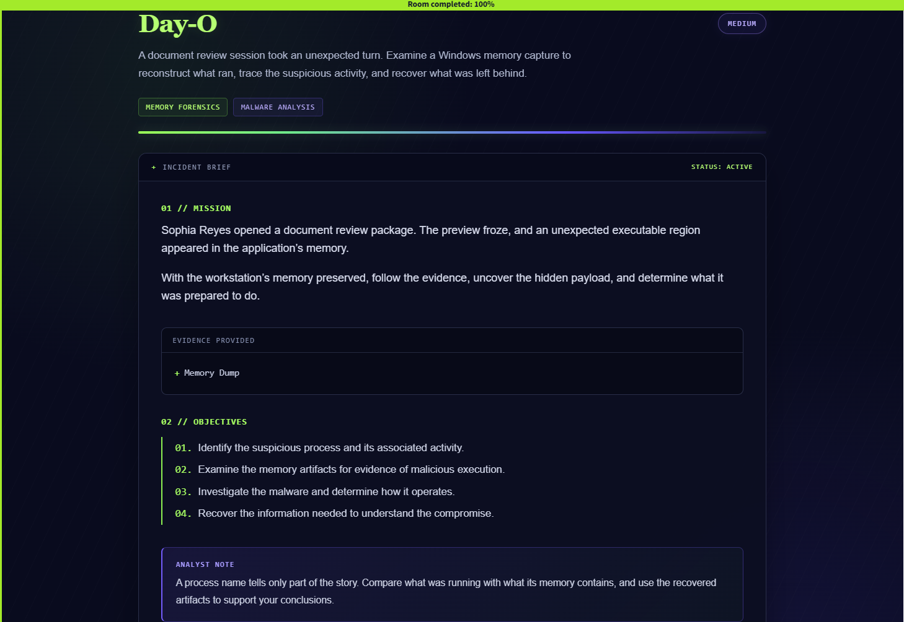
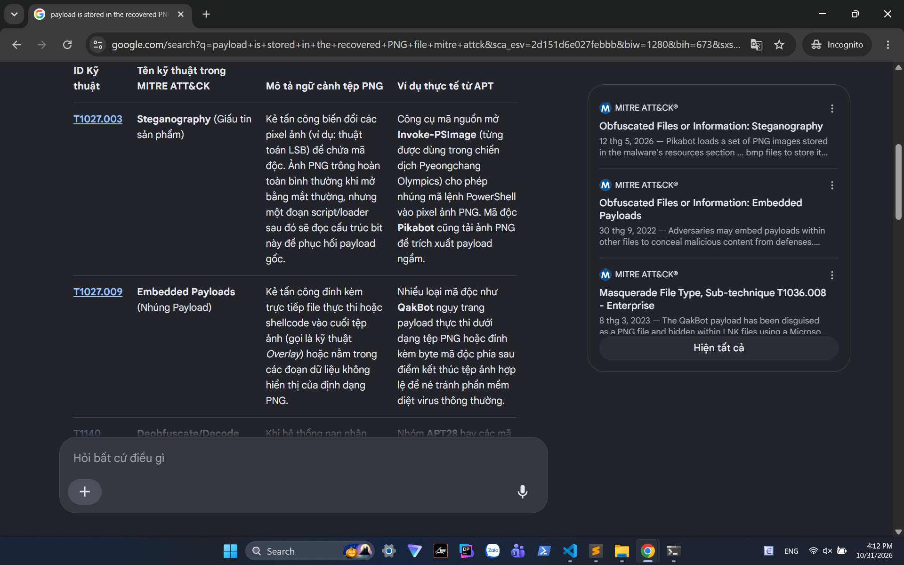
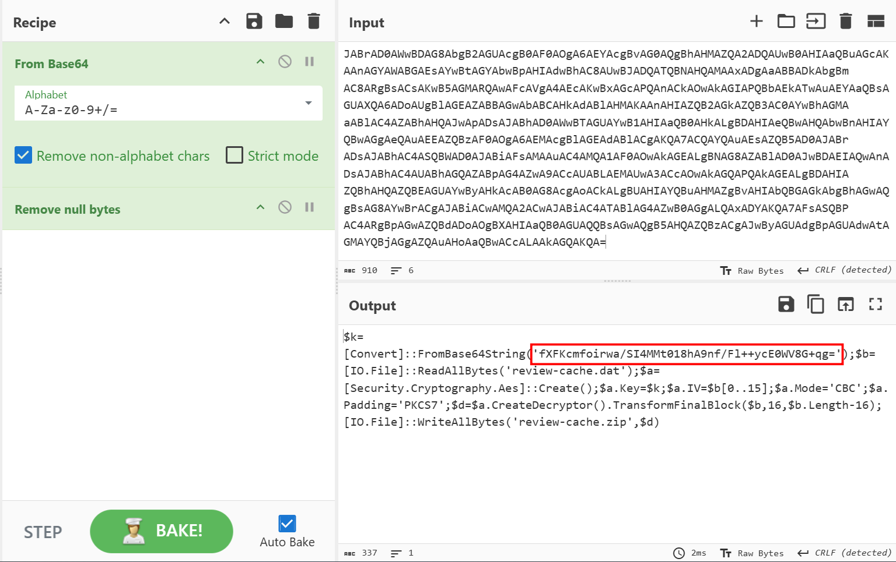
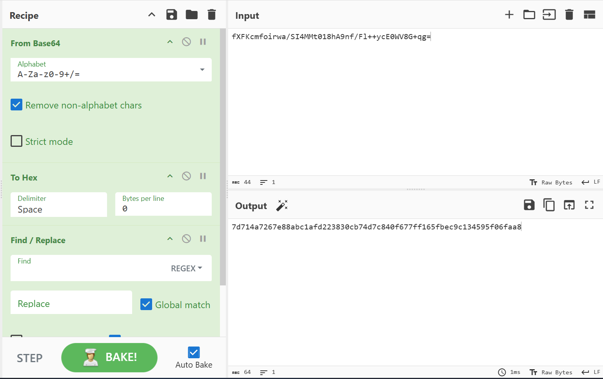
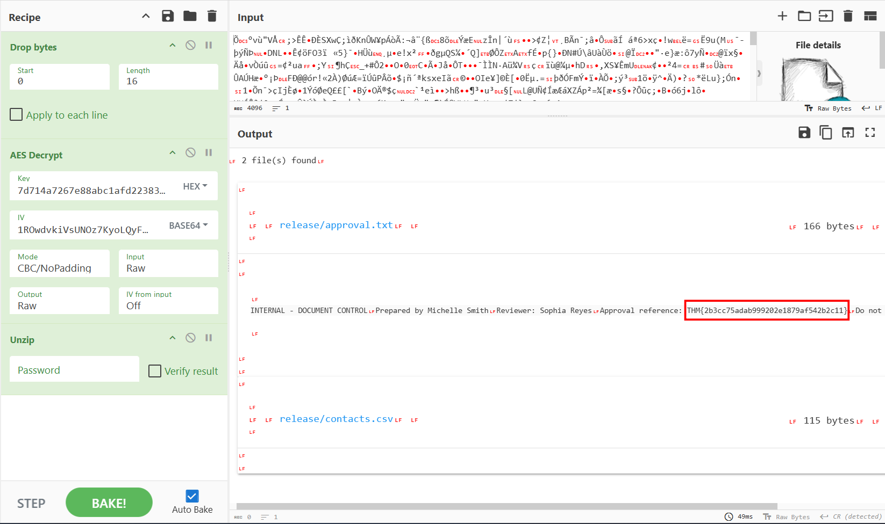

# Day-O

## Challenge scenario



## Artifacts

The solely artifact provided was a memory dump of a compromised machine.

I establish a http server on THM's VM, so that I can download it onto my real machine, using this command.

```
python3 -m http.server 8000 --bind 0.0.0.0
```

## Question 1: Which executable contains the suspicious payload?

At first, I check for its basic information using `windows.info`

```
luongdung@lngdun:/mnt/c/Users/ADMIN/Downloads$ vol -f memory.mem windows.info
Volatility 3 Framework 2.27.0
Progress:  100.00               PDB scanning finished
Variable        Value

Kernel Base     0xf8061f000000
DTB     0x1aa000
Symbols file:///home/luongdung/.local/share/pipx/venvs/volatility3/lib/python3.12/site-packages/volatility3/symbols/windows/ntkrnlmp.pdb/68A17FAF3012B7846079AEECDBE0A583-1.json.xz
Is64Bit True
IsPAE   False
layer_name      0 WindowsIntel32e
memory_layer    1 Elf64Layer
base_layer      2 FileLayer
KdVersionBlock  0xf8061fc0f398
Major/Minor     15.19041
MachineType     34404
KeNumberProcessors      2
SystemTime      2026-10-05 03:54:42+00:00
NtSystemRoot    C:\Windows
NtProductType   NtProductWinNt
NtMajorVersion  10
NtMinorVersion  0
PE MajorOperatingSystemVersion  10
PE MinorOperatingSystemVersion  0
PE Machine      34404
PE TimeDateStamp        Wed Jun 28 04:14:26 1995
```

The process must appear during `pslist` command, but i cannot confirm which one in all those processes. So from the question "contain suspicious payload", I think about `malfind` plugin, which lists process memory ranges that potentially contain injected code (deprecated).

And I found out this executable stood out.

```
6260    ReviewClient.e  0x8e0000        0x8e0fff        VadS    PAGE_EXECUTE_READWRITE  1       1       Disabled        Function prologue
55 89 e5 83 ec 18 31 f6 56 6a 63 66 68 78 65 68 U.....1.Vjcfhxeh
57 69 6e 45 89 65 fc 64 8b 5e 30 8b 5b 0c 8b 5b WinE.e.d.^0.[..[
14 8b 1b 8b 1b 8b 5b 10 89 5d f8 8b 43 3c 01 d8 ......[..]..C<..
8b 40 78 01 d8 8b 48 24 01 d9 89 4d f4 31 c9 41 .@x...H$...M.1.A        55 89 e5 83 ec 18 31 f6 56 6a 63 66 68 78 65 68 57 69 6e 45 89 65 fc 64 8b 5e 30 8b 5b 0c 8b 5b 14 8b 1b 8b 1b 8b 5b 10 89 5d f8 8b 43 3c 01 d8 8b 40 78 01 d8 8b 48 24 01 d9 89 4d f4 31 c9 41
```

Notably, those machine code can be dissamble to

```
push ebp
mov  ebp, esp
sub  esp, 0x18
xor  esi, esi
push esi
push 0x63
pushw 0x6578
push 0x456e6957
mov  [ebp-0x4], esp
```

This push the string `WinExec` to stack for furthur DLL load.

This executable even located in `Downloads` folder, which confirm the answer.

```
luongdung@lngdun:/mnt/c/Users/ADMIN/Downloads$ vol -f memory.mem windows.cmdline.CmdLine --pid 6260
Volatility 3 Framework 2.27.0
Progress:  100.00               PDB scanning finished
PID     Process Args

6260    ReviewClient.e  "C:\Users\s.reyes\Downloads\DocumentReview\ReviewClient.exe"
```

**ANSWER: ReviewClient.exe**

## Question 2: What is the starting virtual address of its private executable memory region?

We already have the answer from `malfind` plugin.

**ANSWER: 0x8e0000**

## Question 3: Which file associated with the process also contains the same payload?

For this question, I used `handles` plugin, which list handles open by that `ReviewClient.exe`, or particularly, having PID 6260.

```
luongdung@lngdun:/mnt/c/Users/ADMIN/Downloads$ vol -f memory.mem windows.handles.Handles --pid 6260 | grep File
6260ressReviewClient.e  0xbd8fdbca2640an0x40 finFile    0x100020        \Device\HarddiskVolume1\Windows
6260    ReviewClient.e  0xbd8fdbcb0bf0  0x84    File    0x100020        \Device\HarddiskVolume1\Users\s.reyes\Downloads\DocumentReview
6260    ReviewClient.e  0xbd8fdbcb3c60  0x108   File    0x120089        \Device\HarddiskVolume1\Users\s.reyes\Downloads\DocumentReview\review-cache.dat
6260    ReviewClient.e  0xbd8fdbcb5a10  0x10c   File    0x120089        \Device\HarddiskVolume1\Users\s.reyes\Downloads\DocumentReview\review-cover.png
6260    ReviewClient.e  0xbd8fdbcb7180  0x1a0   File    0x100001        \Device\HarddiskVolume1\Windows\SysWOW64\en-US\user32.dll.mui
6260    ReviewClient.e  0xbd8fdbcb77c0  0x1b8   File    0x100001        \Device\CNG
6260    ReviewClient.e  0xbd8fdbcbb190  0x254   File    0x120089        \Device\HarddiskVolume1\Windows\Fonts\StaticCache.dat
luongdung@lngdun:/mnt/c/Users/ADMIN/Downloads$
```

I spotted two malicious files located in the same folder as `ReviewClient.exe`, which is `review-cache.dat` and `review-cover.png`. The answer for this one is `review-cover.png`, the `.dat` file will be used for furthur questions.

**ANSWER: review-cover.png**

## Question 4: Which MITRE ATT&CK sub-technique best describes how the payload is stored in the recovered PNG file?

Just some google for `payload embedded in PNG files` leads to two results.



But this one is looking-alike embedded rather than steganography.

**Answer: T1027.009**

## Question 5: Which Windows API does the payload call to launch its next stage?

First, I dumped the private memory region having execute permission of this `ReviewClient.exe` out.

```
luongdung@lngdun:/mnt/c/Users/ADMIN/Downloads$ vol -f memory.mem -o extracted windows.malware.malfind --pid 6260 --dump
Volatility 3 Framework 2.27.0
Progress:  100.00               PDB scanning finished
PID     Process Start VPN       End VPN Tag     Protection      CommitCharge    PrivateMemory   File output     Notes   Hexdump Disasm

6260    ReviewClient.e  0x8e0000        0x8e0fff        VadS    PAGE_EXECUTE_READWRITE  1       1       pid.6260.vad.0x8e0000-0x8e0fff-1.dmp    Function prologue
55 89 e5 83 ec 18 31 f6 56 6a 63 66 68 78 65 68 U.....1.Vjcfhxeh
57 69 6e 45 89 65 fc 64 8b 5e 30 8b 5b 0c 8b 5b WinE.e.d.^0.[..[
14 8b 1b 8b 1b 8b 5b 10 89 5d f8 8b 43 3c 01 d8 ......[..]..C<..
8b 40 78 01 d8 8b 48 24 01 d9 89 4d f4 31 c9 41 .@x...H$...M.1.A        55 89 e5 83 ec 18 31 f6 56 6a 63 66 68 78 65 68 57 69 6e 45 89 65 fc 64 8b 5e 30 8b 5b 0c 8b 5b 14 8b 1b 8b 1b 8b 5b 10 89 5d f8 8b 43 3c 01 d8 8b 40 78 01 d8 8b 48 24 01 d9 89 4d f4 31 c9 41
luongdung@lngdun:/mnt/c/Users/ADMIN/Downloads$ cd extracted
luongdung@lngdun:/mnt/c/Users/ADMIN/Downloads/extracted$ file * | grep 6260
6260.ReviewClient.e.0x920000.dmp:                                          PE32 executable (GUI) Intel 80386, for MS Windows, 5 sections
pid.6260.vad.0x8e0000-0x8e0fff-1.dmp:                                      data
pid.6260.vad.0x8e0000-0x8e0fff.dmp:                                        data
```

For this task, I set up a `Speakeasy` virtual enviroment, any using its CLI to execute this payload in sandbox. 

> Speakeasy is a malware analysis tool developed by Mandiant that safely emulates malicious code without executing it directly on your computer. It simulates CPU instructions and Windows APIs to observe how malware behaves. This helps security analysts identify suspicious activities, such as launching programs, accessing files, or connecting to malicious servers.

```
luongdung@lngdun:/mnt/c/Users/ADMIN/Downloads/extracted$ ~/speakeasy-venv/bin/python -m speakeasy.cli -t pid.6260.vad.0x8e0000-0x8e0fff.dmp --raw --arch x86 -o report.json
Emulated filesystem: 4 full_path entries
* Active Speakeasy configuration
  config_version = 0.2
  description = Default emulation profile to use when not overridden by user
  emu_engine = unicorn
  timeout = 60.0
  max_total_time = 0.0
  max_api_count = 10000
  max_instructions = -1
  stack_size = 0
  system = windows
  analysis.memory_tracing = false
  analysis.strings = true
  analysis.coverage = false
  keep_memory_on_free = false
  snapshot_memory_regions = false
  exceptions.dispatch_handlers = true
  os_ver.name = windows
  os_ver.major = 6
  os_ver.minor = 1
  os_ver.release = null
  os_ver.build = 7601
  current_dir = C:\Windows\system32
  command_line = svchost.exe myarg1 myarg2
  env = {"allusersprofile": "C:\\ProgramData", "comspec": "C:\\Windows\\system32\\cmd.exe", "programfiles": "C:\\Program Files", "systemdrive": "C:",
"systemroot": "C:\\Windows", "temp": "C:\\Windows\\temp\\", "userprofile": "C:\\Users\\speakeasy_user", "windir": "C:\\Windows"}
  domain = speakeasy_domain
  hostname = speakeasy_host
  user.name = speakeasy_user
  user.is_admin = true
  user.sid = S-1-5-21-1111111111-2222222222-3333333333-1001
  api_hammering.enabled = false
  api_hammering.threshold = 2000
  api_hammering.allow_list = []
  symlinks = [{"name": "\\??\\C:", "target": "\\Device\\HarddiskVolume1"}, {"name": "\\??\\PhysicalDrive0", "target": "\\Device\\Harddisk0\\DR0"}]
  drives = [{"drive_type": "DRIVE_FIXED", "root_path": "C:\\", "volume_guid_path": "\\\\?\\Volume{bb1d6623-5e53-11ea-a949-100000000001}\\"}, {"drive_type":
"DRIVE_CDROM", "root_path": "D:\\", "volume_guid_path": "\\\\?\\Volume{bb1d6623-5e53-11ea-a949-100000000002}\\"}, {"drive_type": "DRIVE_REMOTE",
"root_path": "E:\\", "volume_guid_path": "\\\\?\\Volume{bb1d6623-5e53-11ea-a949-100000000003}\\"}, {"drive_type": "DRIVE_REMOVABLE", "root_path": "F:\\",
"volume_guid_path": "\\\\?\\Volume{bb1d6623-5e53-11ea-a949-100000000004}\\"}]
  filesystem.files = [{"byte_fill": {"byte": "0x41", "size": 512}, "emu_path": "c:\\programdata\\mydir\\myfile.bin", "mode": "full_path", "path": null},
{"byte_fill": null, "emu_path": "c:\\Windows\\system32\\cmd.exe", "mode": "full_path", "path": "$ROOT$/resources/files/default.bin"}, {"byte_fill": null,
"emu_path": "c:\\Windows\\system32\\svchost.exe", "mode": "full_path", "path": "$ROOT$/resources/files/default.bin"}, {"byte_fill": null, "ext": "exe",
"mode": "by_ext", "path": "$ROOT$/resources/files/default.bin"}, {"byte_fill": null, "ext": "txt", "mode": "by_ext", "path":
"$ROOT$/resources/files/default.bin"}, {"byte_fill": null, "emu_path": "\\\\.\\pipe*", "mode": "full_path", "path": "$ROOT$/resources/web/stager.bin"}]
  registry.keys = [{"path": "HKEY_LOCAL_MACHINE\\System\\CurrentControlSet\\Services\\usbsamp", "values": [{"data": "An example service", "name":
"DisplayName", "type": "REG_SZ"}, {"data": "0x00000003", "name": "Start", "type": "REG_DWORD"}]}, {"path":
"HKEY_CLASSES_ROOT\\Interface\\{b196b287-bab4-101a-b69c-00aa00341d07}", "values": [{"data": "IEnumConnections", "name": "default", "type": "REG_SZ"}]},
{"path": "HKEY_LOCAL_MACHINE\\Software\\Microsoft\\Windows\\CurrentVersion\\Uninstall", "values": [{"data": "IEnumConnections", "name": "default", "type":
"REG_SZ"}]}, {"path": "HKEY_LOCAL_MACHINE\\SOFTWARE\\Microsoft\\Windows NT\\CurrentVersion\\Windows", "values": []}]
  network.dns.names = {"default": "10.1.2.3", "google.com": "8.8.8.8", "localhost": "127.0.0.1", "speakeasy_host": "127.0.0.1"}
  network.dns.txt = [{"name": "default", "path": "$ROOT$/resources/web/default.bin"}]
  network.http.responses = [{"files": [{"byte_fill": null, "mode": "default", "path": "$ROOT$/resources/web/default.bin"}, {"byte_fill": null, "ext": "gif",
"mode": "by_ext", "path": "$ROOT$/resources/web/decoy.gif"}, {"byte_fill": null, "ext": "jpg", "mode": "by_ext", "path": "$ROOT$/resources/web/decoy.jpg"}],
"verb": "GET"}]
  network.winsock.responses = [{"byte_fill": null, "mode": "default", "path": "$ROOT$/resources/web/stager.bin"}]
  network.adapters = [{"description": "Intel(R) PRO/1000 MT Network Connection", "dhcp_enabled": true, "ip_address": "127.0.0.1", "mac_address":
"00-13-CE-12-34-56", "name": "{00000000-0000-0000-0000-000000000000}", "subnet_mask": "255.0.0.0", "type": "ethernet"}]
  processes = [{"base_addr": "0x80000000", "command_line": null, "is_main_exe": null, "name": "System", "path": "[System Process]", "pid": 4, "session":
null}, {"base_addr": "0x05000000", "command_line": null, "is_main_exe": null, "name": "smss", "path": "C:\\Windows\\system32\\smss.exe", "pid": null,
"session": null}, {"base_addr": "0x05510000", "command_line": null, "is_main_exe": null, "name": "csrss", "path": "C:\\Windows\\system32\\csrss.exe", "pid":
null, "session": null}, {"base_addr": "0x05520000", "command_line": null, "is_main_exe": null, "name": "wininit", "path":
"C:\\Windows\\system32\\wininit.exe", "pid": null, "session": null}, {"base_addr": "0x05530000", "command_line": null, "is_main_exe": null, "name":
"services", "path": "C:\\Windows\\system32\\services.exe", "pid": null, "session": null}, {"base_addr": "0x05540000", "command_line": null, "is_main_exe":
null, "name": "lsass", "path": "C:\\Windows\\system32\\lsass.exe", "pid": null, "session": null}, {"base_addr": "0x05550000", "command_line": null,
"is_main_exe": null, "name": "winlogon", "path": "C:\\Windows\\system32\\winlogon.exe", "pid": null, "session": null}, {"base_addr": "0x05560000",
"command_line": null, "is_main_exe": null, "name": "svchost", "path": "C:\\Windows\\system32\\svchost.exe", "pid": null, "session": null}, {"base_addr":
"0x05590000", "command_line": null, "is_main_exe": null, "name": "outlook", "path": "C:\\Windows\\system32\\outlook.exe", "pid": null, "session": null},
{"base_addr": "0x05570000", "command_line": null, "is_main_exe": null, "name": "explorer", "path": "C:\\Windows\\explorer.exe", "pid": null, "session":
null}, {"base_addr": "0x00400000", "command_line": "svchost.exe", "is_main_exe": true, "name": "main", "path": "C:\\Windows\\system32\\svchost.exe", "pid":
null, "session": 1}]
  modules.modules_always_exist = false
  modules.functions_always_exist = false
  modules.module_directory_x86 = null
  modules.module_directory_x64 = null
  modules.user_modules = [{"base_addr": "0x7C000000", "images": [], "name": "ntdll", "path": "C:\\Windows\\system32\\ntdll.dll"}, {"base_addr":
"0x77000000", "images": [], "name": "kernel32", "path": "C:\\Windows\\system32\\kernel32.dll"}, {"base_addr": "0x78C00000", "images": [], "name": "ws2_32",
"path": "C:\\Windows\\system32\\ws2_32.dll"}, {"base_addr": "0x7BC00000", "images": [], "name": "wininet", "path": "C:\\Windows\\system32\\wininet.dll"},
{"base_addr": "0x7BA00000", "images": [], "name": "winhttp", "path": "C:\\Windows\\system32\\winhttp.dll"}, {"base_addr": "0x78000000", "images": [],
"name": "advapi32", "path": "C:\\Windows\\system32\\advapi32.dll"}, {"base_addr": "0x71000000", "images": [], "name": "psapi", "path":
"C:\\Windows\\system32\\psapi.dll"}, {"base_addr": "0x77D10000", "images": [], "name": "user32", "path": "C:\\Windows\\system32\\user32.dll"}, {"base_addr":
"0x77E10000", "images": [], "name": "gdi32", "path": "C:\\Windows\\system32\\gdi32.dll"}, {"base_addr": "0x77F10000", "images": [], "name": "msvcrt",
"path": "C:\\Windows\\system32\\msvcrt.dll"}, {"base_addr": "0x78F10000", "images": [], "name": "dnsapi", "path": "C:\\Windows\\system32\\dnsapi.dll"},
{"base_addr": "0x67000000", "images": [], "name": "shlwapi", "path": "C:\\Windows\\system32\\shlwapi.dll"}, {"base_addr": "0x68F00000", "images": [],
"name": "advpack", "path": "C:\\Windows\\system32\\advpack.dll"}, {"base_addr": "0x62000000", "images": [], "name": "dbghelp", "path":
"C:\\Windows\\system32\\dbghelp.dll"}, {"base_addr": "0x69000000", "images": [], "name": "shell32", "path": "C:\\Windows\\system32\\shell32.dll"},
{"base_addr": "0x63000000", "images": [], "name": "WTSAPI32", "path": "C:\\Windows\\system32\\WTSAPI32.dll"}, {"base_addr": "0x58000000", "images": [],
"name": "CRYPT32", "path": "C:\\Windows\\system32\\CRYPT32.dll"}, {"base_addr": "0x53000000", "images": [], "name": "mscoree", "path":
"C:\\Windows\\system32\\mscoree.dll"}, {"base_addr": "0x54500000", "images": [], "name": "urlmon", "path": "C:\\Windows\\system32\\urlmon.dll"},
{"base_addr": "0x56500000", "images": [], "name": "riched32", "path": "C:\\Windows\\system32\\riched32.dll"}, {"base_addr": "0x76500000", "images": [],
"name": "userenv", "path": "C:\\Windows\\system32\\userenv.dll"}, {"base_addr": "0x65500000", "images": [], "name": "ole32", "path":
"C:\\Windows\\system32\\ole32.dll"}, {"base_addr": "0x75500000", "images": [], "name": "gdiplus", "path": "C:\\Windows\\system32\\gdiplus.dll"},
{"base_addr": "0x55500000", "images": [], "name": "setupapi", "path": "C:\\Windows\\system32\\setupapi.dll"}, {"base_addr": "0x54400000", "images": [],
"name": "NETAPI32", "path": "C:\\Windows\\system32\\NETAPI32.dll"}, {"base_addr": "0x53300000", "images": [], "name": "rpcrt4", "path":
"C:\\Windows\\system32\\Rpcrt4.dll"}, {"base_addr": "0x63300000", "images": [], "name": "linkinfo", "path": "C:\\Windows\\system32\\linkinfo.dll"},
{"base_addr": "0x73300000", "images": [], "name": "EhStorShell", "path": "C:\\Windows\\system32\\EhStorShell.dll"}, {"base_addr": "0x5f500000", "images":
[], "name": "comctl32", "path": "C:\\Windows\\system32\\comctl32.dll"}, {"base_addr": "0x5f600000", "images": [], "name": "secur32", "path":
"C:\\Windows\\system32\\secur32.dll"}, {"base_addr": "0x5f700000", "images": [], "name": "KtmW32", "path": "C:\\Windows\\system32\\KtmW32.dll"},
{"base_addr": "0x5f800000", "images": [], "name": "oleaut32", "path": "C:\\Windows\\system32\\oleaut32.dll"}, {"base_addr": "0x5f900000", "images": [],
"name": "bcrypt", "path": "C:\\Windows\\system32\\bcrypt.dll"}, {"base_addr": "0x5fa00000", "images": [], "name": "ncrypt", "path":
"C:\\Windows\\system32\\ncrypt.dll"}, {"base_addr": "0x5fb00000", "images": [], "name": "netutils", "path": "C:\\Windows\\system32\\netutils.dll"},
{"base_addr": "0x5fc00000", "images": [], "name": "wkscli", "path": "C:\\Windows\\system32\\wkscli.dll"}, {"base_addr": "0x5fd00000", "images": [], "name":
"iphlpapi", "path": "C:\\Windows\\system32\\iphlpapi.dll"}, {"base_addr": "0x5fe00000", "images": [], "name": "sfc_os", "path":
"C:\\Windows\\system32\\sfc_os.dll"}, {"base_addr": "0x5ff00000", "images": [], "name": "winmm", "path": "C:\\Windows\\system32\\winmm.dll"}, {"base_addr":
"0x60000000", "images": [], "name": "bcryptprimitives", "path": "C:\\Windows\\system32\\bcryptprimitives.dll"}, {"base_addr": "0x60100000", "images": [],
"name": "version", "path": "C:\\Windows\\system32\\version.dll"}]
  modules.system_modules = [{"base_addr": "0x803d0000", "driver": null, "name": "ntoskrnl", "path": "C:\\Windows\\system32\\ntoskrnl.exe"}, {"base_addr":
"0xC1000000", "driver": null, "name": "hal", "path": "C:\\Windows\\system32\\hal.dll"}, {"base_addr": "0xC2000000", "driver": null, "name": "ntfs", "path":
"C:\\Windows\\system32\\drivers\\ntfs.sys"}, {"base_addr": "0xD4000000", "driver": null, "name": "netio", "path":
"C:\\Windows\\system32\\drivers\\netio.sys"}, {"base_addr": "0xC6000000", "driver": {"devices": [{"name": "\\Device\\HarddiskVolume1"}], "name":
"\\Driver\\volmgr"}, "name": "volmgr", "path": "C:\\Windows\\system32\\drivers\\volmgr.sys"}, {"base_addr": "0xC3000000", "driver": {"devices": [{"name":
"\\Device\\Harddisk0\\DR0"}], "name": "\\Driver\\Disk"}, "name": "disk", "path": "C:\\Windows\\system32\\drivers\\disk.sys"}, {"base_addr": "0xC4000000",
"driver": {"devices": [{"name": "\\Device\\Tcp"}], "name": "\\Driver\\Tcpip"}, "name": "tcpip", "path": "C:\\Windows\\system32\\drivers\\tcpip.sys"},
{"base_addr": "0xC7000000", "driver": {"devices": [{"name": "\\Device\\Ndis"}], "name": "\\Driver\\Ndis"}, "name": "ndis", "path":
"C:\\Windows\\system32\\drivers\\ndis.sys"}]
* exec: shellcode
0x153d: 'kernel32.WinExec(lpCmdLine: "powershell.exe -NoProfile -EncodedCommand
JABrAD0AWwBDAG8AbgB2AGUAcgB0AF0AOgA6AEYAcgBvAG0AQgBhAHMAZQA2ADQAUwB0AHIAaQBuAGcAKAAnAGYAWABGAEsAYwBtAGYAbwBpAHIAdwBhAC8AUwBJADQATQBNAHQAMAAxADgAaABBADkAbgBm
AC8ARgBsACsAKwB5AGMARQAwAFcAVgA4AEcAKwBxAGcAPQAnACkAOwAkAGIAPQBbAEkATwAuAEYAaQBsAGUAXQA6ADoAUgBlAGEAZABBAGwAbABCAHkAdABlAHMAKAAnAHIAZQB2AGkAZQB3AC0AYwBhAGMA
aABlAC4AZABhAHQAJwApADsAJABhAD0AWwBTAGUAYwB1AHIAaQB0AHkALgBDAHIAeQBwAHQAbwBnAHIAYQBwAGgAeQAuAEEAZQBzAF0AOgA6AEMAcgBlAGEAdABlACgAKQA7ACQAYQAuAEsAZQB5AD0AJABr
ADsAJABhAC4ASQBWAD0AJABiAFsAMAAuAC4AMQA1AF0AOwAkAGEALgBNAG8AZABlAD0AJwBDAEIAQwAnADsAJABhAC4AUABhAGQAZABpAG4AZwA9ACcAUABLAEMAUwA3ACcAOwAkAGQAPQAkAGEALgBDAHIA
ZQBhAHQAZQBEAGUAYwByAHkAcAB0AG8AcgAoACkALgBUAHIAYQBuAHMAZgBvAHIAbQBGAGkAbgBhAGwAQgBsAG8AYwBrACgAJABiACwAMQA2ACwAJABiAC4ATABlAG4AZwB0AGgALQAxADYAKQA7AFsASQBP
AC4ARgBpAGwAZQBdADoAOgBXAHIAaQB0AGUAQQBsAGwAQgB5AHQAZQBzACgAJwByAGUAdgBpAGUAdwAtAGMAYQBjAGgAZQAuAHoAaQBwACcALAAkAGQAKQA=", uCmdShow: 0x5)' -> 0x20
```

We can see that kernel32.WinExec was used to execute a Powershell encoded command, which is noted as shellcode.

**ANSWER: kernel32.WinExec**

## Question 6: What encryption key does the decoded stage use to decrypt the document cache?

Decode the previous Powershell command to have the AES key used for encryption.



The answer required in hexadecimal format, so just convert it



**ANSWER: 7d714a7267e88abc1afd223830cb74d7c840f677ff165fbec9c134595f06faa8**

## Question 7: What is the flag?

The Powershell script taking first 16 bytes from `review-cache.dat` (which we have already seen in previous tasks) to be used as IV for AES-256-CBC decryption, the remaining bytes as ciphertext.

So I export the `review-cache.dat` using its virtual address and decrypt it to restore the ZIP file.

```
luongdung@lngdun:/mnt/c/Users/ADMIN/Downloads$ vol -f memory.mem windows.filescan.FileScan | grep "review-cache.dat"
0xbd8fdbca6650.0\Users\s.reyes\Downloads\DocumentReview\review-cache.dat
0xbd8fdbcb3c60  \Users\s.reyes\Downloads\DocumentReview\review-cache.dat
0xbd8fdbe27d00  \LabTransfer\review-cache.dat

luongdung@lngdun:/mnt/c/Users/ADMIN/Downloads$ vol -f memory.mem -o extracted windows.dumpfiles --virtaddr 0xbd8fdbca6650
Volatility 3 Framework 2.27.0
Progress:  100.00               PDB scanning finished
Cache   FileObject      FileName        Result

DataSectionObject       0xbd8fdbca6650  review-cache.dat        file.0xbd8fdbca6650.0xbd8fdc40ce10.DataSectionObject.review-cache.dat-1.dat
SharedCacheMap  0xbd8fdbca6650  review-cache.dat        file.0xbd8fdbca6650.0xbd8fdc2f6d40.SharedCacheMap.review-cache.dat-1.vacb
```

Rename it and used the exact same Powershell code for decryption.



**ANSWER: THM{2b3cc75adab999202e1879af542b2c11}**